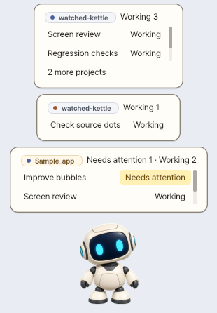
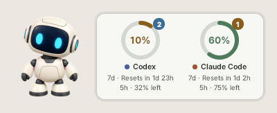
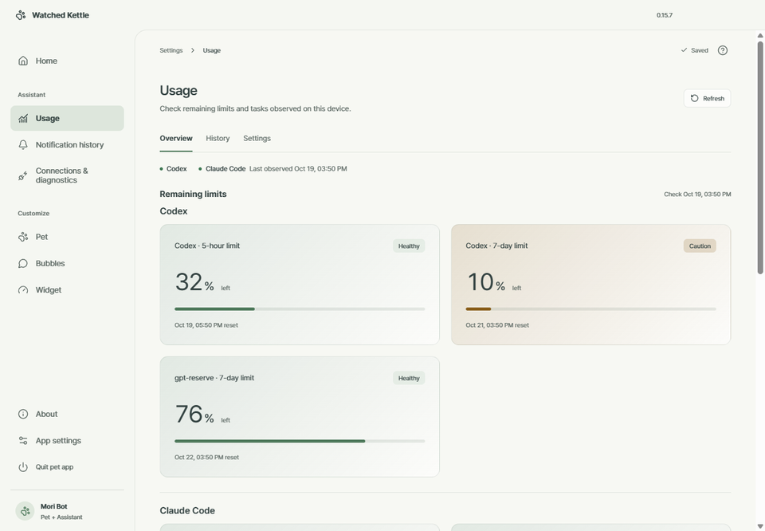
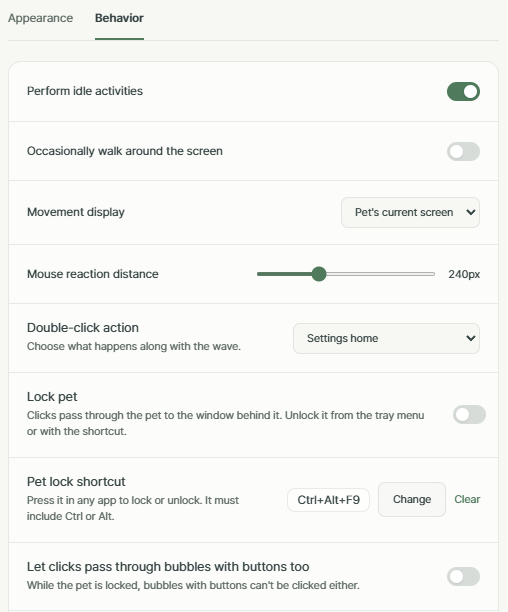

# Watched Kettle

[한국어](README.md) · [English](README.en.md)

[Roadmap (Korean)](ROADMAP.md) · [0.15.10 release notes](docs/release-notes/v0.15.10.en.md) · [Release readiness (Korean)](RELEASE_READINESS.md)

**A desktop pet that keeps you posted on your coding agents**

<a href="https://github.com/leewb2280/watched-kettle/releases/latest">
  
</a>

Windows 10 or later · 64-bit · Korean and English UI · Beta

While Codex and Claude Code work, a small pet on your desktop shows their status.
See completed tasks and requests for your attention in speech bubbles, and check your remaining usage limits in a widget.
You can also use the pet on its own, without connecting an agent.



*See active conversations and requests for attention, grouped by project. When you use both tools, source dots tell them apart.*



*Check remaining usage limits and reset times beside the pet. The large percentages show the remaining allowance.*

> A watched pot never boils — let the pet do the watching.

> **Unofficial project.** Watched Kettle is not made or endorsed by, or affiliated with, OpenAI or Anthropic.
> Codex is an OpenAI product; Claude Code is an Anthropic product.

## Quick start

1. **Download:** On the [latest Releases page](https://github.com/leewb2280/watched-kettle/releases/latest), download
   `WatchedKettle-<version>-public-unsigned-setup.exe` and its matching `.exe.sha256` file.
   Verify the SHA-256 as described below, then run the installer.
2. **Choose an edition:** Select **Pet only** (`펫만`) for a desktop companion, or **Pet + assistant** (`펫 + 비서`) for task status and usage information too.
3. **Choose your tools:** For Pet + assistant, select the Codex and/or Claude Code tools you use on this PC.
   Install and sign in to those tools separately first.
4. **Launch and check:** Start Watched Kettle, right-click the pet, and open **Settings** (`설정`).
   In the assistant edition, open **Connections & diagnostics** (`연결·진단`), check each selected tool, and click **Check connection** (`연결 점검`).
   **Restart any Claude Code sessions that were already open**, then run a new task to check the status display.

The app installs for the current user without administrator privileges. The installer and uninstaller offer Korean and English;
the app also supports both languages. Choose a language in App settings and restart.
To translate the app or adjust its text, click **Copy as editable pack** on the same screen:
the app creates a pack with every message and opens its folder. Edit `messages.json` and restart;
untranslated messages appear in English. Community packs can also be installed from local files.
See [Language packs](docs/language-packs.md).

<details>
<summary>Verify the installer's SHA-256</summary>

Save the installer and its `.exe.sha256` file in the same folder, then open PowerShell in that folder.
Replace the filenames below with the version you downloaded.

```powershell
Get-FileHash -LiteralPath '.\WatchedKettle-<version>-public-unsigned-setup.exe' -Algorithm SHA256
Get-Content -LiteralPath '.\WatchedKettle-<version>-public-unsigned-setup.exe.sha256'
```

The first command's `Hash` value must match the hash before the filename in the second command's output (case does not matter).
If they differ, do not run the installer; download both files again.

</details>

The installer is not yet code-signed, so Windows SmartScreen may show a warning.
After checking the release source and SHA-256, you can proceed with More info → Run anyway (`추가 정보 → 실행` on Korean Windows).
See [installation and launch](docs/user-guide.en.md#installation-and-launch) for details.

### Which edition should I choose?

Both editions use one installer. The **Pet only** edition does not include the assistant code.

| | Pet only (`펫만`) | Pet + assistant (`펫 + 비서`) |
| --- | --- | --- |
| Desktop pet, settings, Windows startup | ✅ | ✅ |
| Task status, project bubbles, notifications | – | ✅ |
| Usage widget, notification history | – | ✅ |
| Codex / Claude Code hooks | Not installed | Choose separately for each tool |

Connecting a tool adds only this app's hooks (entries that report task status) to that tool's user settings.
Disconnecting, changing editions, or uninstalling removes only the managed entries, preserving other hooks and settings.

## Features

### Follow task status

Pet + assistant shows working, needs attention, completed, and failed states through the pet's animation and project speech bubbles.
Review past notifications on the **Notification history** page, or pause notifications while you focus.
When using both tools, navy dots identify Codex and orange dots identify Claude Code.

See [supported environments below](#supported-environments) for what happens when you click a conversation title.
Display timing and controls are covered in [project bubbles](docs/user-guide.en.md#project-bubbles).

### Check remaining usage limits

In Pet + assistant, the widget and **Usage** (`사용량`) page show remaining limits, reset times, and today's hourly activity.
**Claude Code limit collection is off by default.** In **Connections & diagnostics** (`연결·진단`), turn on **Claude Code enabled** (`Claude Code 사용`) and then **Collect Claude Code limits** (`한도 가져오기`).
It updates when you use Claude Code in a terminal; using only the VS Code extension panel does not update it.



*Open settings for more usage details and history. The widget supports ring, bar, and chip styles.*

See [usage information](docs/user-guide.en.md#usage) for measurement scope and settings.

### Customize your pet and display

The pet follows your pointer with its gaze, performs idle actions, and can optionally walk left and right.
Adjust its size, opacity, shadow, and always-on-top setting, or add your own pet.
The app remembers your last pet and its position, restoring it to a safe location if your monitor arrangement changes.
It also includes a tray menu, Windows startup, and duplicate-instance prevention.
Double-clicking the pet opens the settings home; you can switch this to **Open Codex** or **Open Claude Code (VS Code)**.
When the pet or widget covers another window, **lock** it so clicks pass through to the window behind, and toggle the lock with a global shortcut of your choice.
Besides PNG/WebP images, pets can be imported from a pet ZIP or folder, a CodexPetDB or Pets Codex install command, or pets installed in Codex.
The **About** page shows the version, what's new in it, and open-source licenses.



*Set the double-click action, the pet lock, and its shortcut in **Customize → Pet → Behavior**.*

Customize bubbles with colors, shapes, borders, photos, and stickers.
See [customization](docs/user-guide.en.md#customization) for settings and the
[pet package format](docs/pet-package-format.en.md) for custom packages, which can include bubble decorations and a halo.

The pet manager lets you search, show or hide, and reorder pets. Move pets you added to the app's trash, restore them, or permanently delete them after confirmation.
Multi-selection shows progress and partial failures and can stop the remaining items. Bundled pets are protected. Trash is separate from the Windows Recycle Bin and is not emptied automatically.

## Supported environments

| Tool / launch environment | Clicking a bubble's conversation title |
| --- | --- |
| Codex Windows app | Opens that conversation. Unverified versions or navigation failures fall back to opening Codex or connection guidance |
| Claude Code — VS Code extension panel | Attempts to open that conversation in the panel; actual click behavior remains unverified |
| Claude Code — VS Code integrated terminal | Brings forward the VS Code window for that folder, without selecting a specific terminal tab |
| Claude Code — other terminals | Opens Watched Kettle's activity list |

Support for the Claude desktop app, other IDEs, and `claude -p` has not been verified.
See [support scope](docs/support-scope.en.md) and
[Claude Code support](docs/support-claude-code.en.md) for environments and verification history.
The pet keeps running if an integration fails.

## Frequently asked questions

### Why does Windows warn about the installer?

The installer is not yet code-signed, so SmartScreen may show a warning.
Confirm that you downloaded it from this repository's Releases and check its SHA-256 before choosing More info → Run anyway
(`추가 정보 → 실행` on Korean Windows). [Installation guide](docs/user-guide.en.md#installation-and-launch)

### The pet is visible, but task status is missing

Check that you installed **Pet + assistant** (`펫 + 비서`). Right-click the pet, open **Settings → Connections & diagnostics** (`설정 → 연결·진단`),
and check the tool's connection state and **Check connection** (`연결 점검`) results.
Restart Claude Code sessions that were open before connecting. [First connection check](docs/user-guide.en.md#first-connection-check)

### Why are Claude Code limits missing?

In **Connections & diagnostics** (`연결·진단`), turn on both **Claude Code enabled** (`Claude Code 사용`) and **Collect Claude Code limits** (`한도 가져오기`).
Limits arrive after the first response in a terminal session with a supported claude.ai Pro or Max subscription.
The VS Code extension panel alone does not update them. [Limit details](docs/support-claude-code.en.md#limits)

### Why does the pet stay when I close settings?

The settings window's X only hides that window. To quit the app, choose **Quit** (`종료`) from the pet's or tray icon's right-click menu,
or **Quit pet app** (`펫 앱 종료`) in settings. [How to quit](docs/user-guide.en.md#quitting-the-app)

### What happens to my settings and history when I update or uninstall?

In **App settings → Version & updates** (`앱 설정 → 버전과 업데이트`), click **Check for updates** (`업데이트 확인`).
If a new release is available, click **Update** (`업데이트`) to download the installer, verify its SHA-256, install, and restart.
With **Check for updates automatically** (`업데이트 자동 확인`, on by default), the app checks once a day and the pet tells you
about a new release. Since 0.15.10, **Install updates automatically** (`업데이트 자동 설치`, on by default) downloads the changed files
and applies them the next time the app starts; when the full installer is needed, it installs only when you click. Your settings, custom pets, and edition choice are preserved.
You can also run a newer installer directly to upgrade.

Uninstall through Windows Installed apps. Choose to keep data (the default), delete history only, or delete all app data.
The uninstaller removes this app's integration entries without deleting Codex or Claude Code conversations.
[Updates](docs/user-guide.en.md#updates) · [Uninstalling and data](docs/user-guide.en.md#uninstalling-and-data)

## Data and privacy

This app has no server of its own and stores its data on this PC. Task status and history come from local Codex and Claude Code data.
Account and task identifiers are stored as hashes. Prompts, responses, commands, tool output, file paths, and email addresses
are not written to the usage database or logs.

The app itself connects to the internet only to check for (when you click, and once a day if automatic checks are on) or download an update (when you click, or with automatic installs) from GitHub,
and to download a pet from a public pet service (CodexPetDB or Pets Codex) when you click **Download** for an install command in Import pet.
Codex usage information is requested from a local Codex process; that process's external communication follows Codex's own behavior.
The installation folder is `%LOCALAPPDATA%\Programs\WatchedKettle`; settings and custom pets are in `%LOCALAPPDATA%\WatchedKettle`.
See [privacy and storage](docs/privacy-and-storage.en.md) for retention and deletion details.

See [SECURITY.en.md](SECURITY.en.md) for issue reporting and private security reports.

## Build from source

<details>
<summary>Show prerequisites and build commands</summary>

Requirements: Windows x64, standard CPython 3.14.x (baseline 3.14.8), Node.js 22 and pnpm. For the installer, Inno Setup 6.7 or later and
the .NET Framework 4.x included with Windows (to compile the launcher).

```powershell
py -3.14 -m venv .venv
.\.venv\Scripts\python.exe -m pip install -r requirements-dev.txt
pnpm --dir settings-ui install --frozen-lockfile --ignore-scripts
node settings-ui/node_modules/electron/install.js

# Run from source (Pet + assistant). For Pet only, use watched_kettle.pet_entrypoint
.\.venv\Scripts\python.exe -m watched_kettle

# Formatting, lint, documentation, settings UI build, types, regression tests
.\scripts\check.ps1

# Both edition bundles and the installer
.\scripts\build_windows.ps1 -Profile Public -Edition PetOnly
.\scripts\build_windows.ps1 -Profile Public -Edition PetAssistant
.\scripts\build_installer.ps1 -PetOnlyBundleRoot dist/public/pet-only/WatchedKettle `
  -AssistantBundleRoot dist/public/pet-assistant/WatchedKettle `
  -Compiler 'C:\Program Files (x86)\Inno Setup 6\ISCC.exe'
```

See [architecture (Korean)](docs/architecture.md), [bubble architecture and maintenance rules (Korean)](docs/bubble-architecture.md),
and [Codex integration (Korean)](docs/codex-integration.md). Report security issues as described in [SECURITY.en.md](SECURITY.en.md).

</details>

## License

- Project code and documentation: [MIT](LICENSE), Copyright (c) 2026 leewb2280.
- Default Mori Bot sprites and app icon: [CC BY 4.0](https://creativecommons.org/licenses/by/4.0/),
  leewb2280 — AI-assisted artwork ([Mori Bot attribution (Korean)](pets/mori-bot/ATTRIBUTION.md), [app icon attribution (Korean)](assets/ATTRIBUTION.md)).
  Redistributions must include attribution, a license link, and an indication of any changes.
- Bundled third-party software (Python, Qt/PySide6, Pillow, the PyInstaller bootloader, Electron, React, and Lucide) and
  the Pretendard font retain their own licenses. See [THIRD_PARTY_NOTICES.md](THIRD_PARTY_NOTICES.md);
  license texts are in the installation folder's `licenses`, `settings-ui/licenses`, and `PRETENDARD_OFL.txt`.

See [release readiness (Korean)](RELEASE_READINESS.md) for the release status and remaining work.
