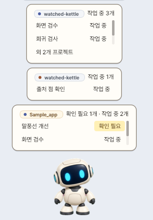
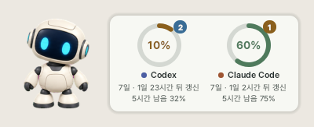
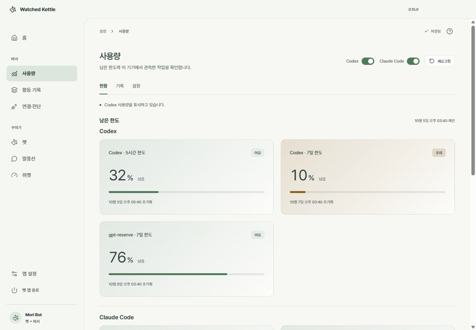

# Watched Kettle

[한국어](README.md) · [English](README.en.md)

[로드맵](ROADMAP.md) · [0.15.5 패치노트](docs/release-notes/v0.15.5.md) · [배포 준비 상태](RELEASE_READINESS.md)

**코딩 에이전트의 작업 상태를 알려 주는 데스크톱 펫**

<a href="https://github.com/leewb2280/watched-kettle/releases/latest">
  
</a>

Windows 10 이상 · 64비트 · 한국어 UI · 베타

Codex와 Claude Code가 작업하는 동안 화면 위의 작은 펫이 상태를 알려 줍니다.
작업 완료나 확인 요청은 말풍선으로 확인하고, 남은 사용 한도는 위젯으로 살펴보세요.
에이전트 연결 없이 펫만 사용할 수도 있습니다.



*프로젝트별로 작업 중인 대화와 확인 요청을 모아 보여 줍니다.*



*펫 옆에서 남은 사용 한도와 초기화 시각을 확인합니다. 위젯의 큰 백분율 숫자는 남은 한도입니다.*

> A watched pot never boils — 지켜보는 주전자는 끓지 않는다.

> **비공식 프로젝트입니다.** Watched Kettle는 OpenAI 또는 Anthropic이 만들거나 승인한 제품이 아니며,
> 두 회사와 관계가 없습니다. Codex는 OpenAI, Claude Code는 Anthropic의 제품입니다.

## 빠르게 시작하기

1. **내려받기:** [최신 Releases](https://github.com/leewb2280/watched-kettle/releases/latest)에서
   `WatchedKettle-<버전>-public-unsigned-setup.exe`와 같은 이름의 `.exe.sha256` 파일을 받습니다.
   아래 방법으로 SHA-256을 확인한 뒤 설치 파일을 실행하세요.
2. **구성 선택:** 펫만 쓰려면 `펫만`, 작업 상태와 사용량도 보려면 `펫 + 비서`를 고릅니다.
3. **도구 선택:** `펫 + 비서`라면 이 PC에서 사용하는 Codex·Claude Code를 선택합니다.
   각 도구는 별도로 설치·로그인해 두어야 합니다.
4. **실행과 확인:** 설치 후 Watched Kettle를 실행하고 펫을 우클릭해 `설정`을 엽니다.
   비서 구성에서는 `연결·진단`에서 선택한 도구의 상태를 보고 `연결 점검`을 누릅니다.
   이미 열려 있던 **Claude Code 세션은 다시 시작**한 뒤 새 작업으로 상태 표시를 확인하세요.

관리자 권한 없이 현재 사용자에게 설치됩니다. 설치·제거 화면은 한국어와 English 중에서 고를 수 있고,
앱 화면은 아직 한국어만 지원합니다.

<details>
<summary>설치 파일의 SHA-256 확인하기</summary>

설치 파일과 `.exe.sha256` 파일을 같은 폴더에 저장하고, 그 폴더에서 PowerShell을 엽니다.
아래 파일명을 실제로 받은 버전의 이름으로 바꿔 실행하세요.

```powershell
Get-FileHash -LiteralPath '.\WatchedKettle-<버전>-public-unsigned-setup.exe' -Algorithm SHA256
Get-Content -LiteralPath '.\WatchedKettle-<버전>-public-unsigned-setup.exe.sha256'
```

첫 명령의 `Hash` 값과 두 번째 명령이 보여 주는 파일명 앞의 해시가 같아야 합니다(대소문자 무관).
다르면 실행하지 말고 두 파일을 다시 내려받으세요.

</details>

설치 파일은 아직 코드 서명이 없어 Windows SmartScreen 경고가 나올 수 있습니다.
배포 출처와 SHA-256을 확인했다면 `추가 정보 → 실행`으로 진행할 수 있습니다.
자세한 절차는 [설치와 실행](docs/user-guide.md#설치와-실행)을 참고하세요.

### 어떤 구성을 고르면 되나요?

한 설치기에서 선택합니다. **펫만** 구성에는 비서 코드가 들어가지 않습니다.

| | 펫만 | 펫+비서 |
| --- | --- | --- |
| 데스크톱 펫·설정창·자동 시작 | ✅ | ✅ |
| 작업 상태·프로젝트 말풍선·알림 | – | ✅ |
| 사용량 위젯·활동 기록 | – | ✅ |
| Codex·Claude Code 연결(hook) | 설치하지 않음 | 도구별로 선택해서 설치 |

연결할 때 각 도구의 사용자 설정에 이 앱의 hook(작업 상태를 전달하는 연결 항목)만 추가합니다.
연결 해제·구성 변경·제거 때도 관리 항목만 지우며, 다른 hook과 설정은 그대로 둡니다.

## 주요 기능

### 작업 상태 확인

펫+비서 구성에서는 작업 중·확인 필요·완료·실패를 펫 동작과 프로젝트별 말풍선으로 확인합니다.
활동 기록에서 지난 알림을 살펴보고, 집중하고 싶을 때는 알림을 잠시 쉴 수 있습니다.
두 도구를 함께 쓰면 Codex는 남색, Claude Code는 주황색 점으로 구분합니다.

말풍선 제목을 눌렀을 때의 동작은 [아래 지원 범위](#지원-범위)를 참고하세요.
표시 시간과 세부 조작은 [프로젝트 말풍선](docs/user-guide.md#프로젝트-말풍선)에 있습니다.

### 남은 한도 확인

펫 옆 위젯과 설정창의 `사용량`에서 남은 한도·초기화 시각·오늘 시간대별 활동을 확인합니다(펫+비서).
**Claude Code 한도는 기본 꺼짐**입니다. `연결·진단`에서 `Claude Code 사용`을 켠 뒤 `한도 가져오기`를 켜야 하며,
터미널에서 Claude Code를 사용할 때 갱신됩니다. VS Code 확장 패널만 사용하면 갱신되지 않습니다.



*더 자세한 사용량과 기록은 설정창에서 확인합니다. 위젯은 링·막대·칩 모양으로 바꿀 수 있습니다.*

측정 범위와 설정은 [사용량 안내](docs/user-guide.md#사용량)를 참고하세요.

### 펫과 화면 꾸미기

펫은 마우스를 따라보고 대기 중 자동 행동을 하며, 선택형 좌우 걷기도 지원합니다.
크기·불투명도·그림자·항상 위를 조절하고 직접 만든 펫을 추가할 수 있습니다.
마지막 펫과 위치를 기억하며, 모니터 구성이 바뀌면 안전한 위치로 복원합니다.
트레이 메뉴, Windows 자동 시작, 중복 실행 방지도 제공합니다.

말풍선은 색·모양·테두리·사진·스티커로 꾸밀 수 있습니다.
자세한 설정은 [꾸미기](docs/user-guide.md#꾸미기), 직접 만든 패키지는
[펫 패키지 규격](docs/pet-package-format.md)을 참고하세요. 패키지에 말풍선 장식과 후광도 포함할 수 있습니다.

펫 관리에서 검색·표시·순서 변경을 하고, 직접 추가한 펫을 앱 전용 휴지통으로 옮겼다가 복원할 수 있습니다.
여러 펫을 골라 한 번에 처리하며 진행·부분 실패·남은 작업 중단도 확인합니다. 기본 제공 펫은 보호하며,
휴지통은 자동으로 비우지 않고 영구 삭제는 확인 후 진행합니다.

## 지원 범위

| 도구·실행 위치 | 말풍선 제목을 누르면 |
| --- | --- |
| Codex Windows 앱 | 해당 대화 열기. 미검증 버전이나 이동 실패 시 Codex 열기 또는 연결 안내로 대체 |
| Claude Code — VS Code 확장 패널 | 패널의 해당 대화 열기 시도. 실제 클릭 동작은 미확인 |
| Claude Code — VS Code 내장 터미널 | 해당 폴더의 VS Code 창 열기(특정 터미널 탭으로 이동하지 않음) |
| Claude Code — 그 밖의 터미널 | Watched Kettle의 활동 목록 열기 |

Claude 데스크톱 앱·다른 IDE·`claude -p`의 지원은 확인하지 않았습니다.
지원 환경과 실제 검증 이력은 [지원 범위](docs/support-scope.md)와
[Claude Code 지원 범위](docs/support-claude-code.md)를 확인하세요. 연결이 실패해도 펫은 계속 동작합니다.

## 자주 묻는 질문

### Windows에서 설치 경고가 나와요

현재 설치 파일에는 코드 서명이 없어 SmartScreen이 경고할 수 있습니다.
이 저장소의 Releases에서 받은 파일인지와 SHA-256을 확인한 뒤 `추가 정보 → 실행`으로 진행하세요.
[설치 안내](docs/user-guide.md#설치와-실행)

### 펫은 보이는데 작업 상태가 나오지 않아요

`펫 + 비서` 구성을 설치했는지 확인하고, 펫 우클릭 → `설정 → 연결·진단`에서 해당 도구의
연결 상태와 `연결 점검` 결과를 확인하세요. Claude Code는 연결 전에 열려 있던 세션을 다시 시작해야 합니다.
[첫 연결 확인](docs/user-guide.md#첫-연결-확인)

### Claude Code 한도가 표시되지 않아요

`연결·진단`에서 `Claude Code 사용`과 `한도 가져오기`를 켰는지 확인하세요.
한도는 지원되는 claude.ai Pro·Max 구독의 터미널 세션에서 첫 응답 이후에 들어옵니다.
VS Code 확장 패널만으로는 갱신되지 않습니다. [한도 안내](docs/support-claude-code.md#한도)

### 설정창을 닫아도 펫이 남아 있어요

설정창의 X는 설정창만 숨깁니다. 앱을 끝내려면 펫 또는 트레이 우클릭 메뉴의 `종료`,
설정창의 `펫 앱 종료`를 누르세요. [종료 방법](docs/user-guide.md#앱-종료)

### 업데이트하거나 삭제하면 설정과 기록은 어떻게 되나요?

`앱 설정 → 버전과 업데이트`에서 `업데이트 확인`을 누릅니다. 새 버전이 있으면 `업데이트`를 눌러
설치 파일 다운로드·SHA-256 검증·설치·재시작을 진행합니다. `업데이트 자동 확인`을 켜 두면(기본) 하루에 한 번
새 버전을 확인해 펫이 알려 주고, 설치는 직접 누를 때만 합니다. 설정·사용자 펫·구성 선택은 유지됩니다. 새 설치 파일을 직접 실행해 업그레이드해도 됩니다.

제거는 Windows `설치된 앱`에서 합니다. 데이터 유지(기본)·기록만 삭제·모두 삭제 중에서 고르며,
Codex·Claude Code 자체의 대화는 삭제하지 않고 이 앱의 연결 항목만 정리합니다.
[업데이트](docs/user-guide.md#업데이트) · [제거와 데이터](docs/user-guide.md#제거와-데이터)

## 데이터와 개인정보

이 앱에는 자체 서버가 없고 데이터는 이 PC에 저장합니다. 작업 상태와 기록은 로컬 Codex·Claude Code에서 읽습니다.
계정과 작업 식별자는 해시로 저장하고, 프롬프트·응답·명령·도구 출력·파일 경로·이메일은
사용량 DB와 로그에 남기지 않습니다.

앱이 직접 인터넷에 연결하는 경우는 업데이트를 확인(누를 때와 자동 확인의 하루 한 번)하거나 설치할 때 GitHub에 요청하는 경우입니다.
Codex 사용량은 로컬 Codex 프로그램에 요청하며, 그 프로그램의 외부 통신은 Codex의 동작을 따릅니다.
설치 위치는 `%LOCALAPPDATA%\Programs\WatchedKettle`, 설정과 사용자 펫은 `%LOCALAPPDATA%\WatchedKettle`입니다.
보관 범위와 삭제 방법은 [개인정보와 저장소](docs/privacy-and-storage.md)를 참고하세요.

문제 보고와 보안 신고 방법은 [SECURITY.md](SECURITY.md)에 있습니다.

## 직접 빌드하기

<details>
<summary>개발 환경과 빌드 명령 보기</summary>

필요한 것: Windows x64, 일반 CPython 3.14.x(기준 3.14.8), Node.js 22와 pnpm, (설치기) Inno Setup 6.7 이상과 Windows에 포함된 .NET Framework 4.x(실행기 컴파일).

```powershell
py -3.14 -m venv .venv
.\.venv\Scripts\python.exe -m pip install -r requirements-dev.txt
pnpm --dir settings-ui install --frozen-lockfile --ignore-scripts
node settings-ui/node_modules/electron/install.js

# 소스 실행 (펫+비서). 펫만 구성은 watched_kettle.pet_entrypoint
.\.venv\Scripts\python.exe -m watched_kettle

# 포맷·린트·문서·설정창 빌드·타입·회귀 테스트
.\scripts\check.ps1

# 위 검사에 커버리지 게이트·의존성 감사까지 포함 (전체 테스트 1회)
.\scripts\check.ps1 -Quality

# 두 구성 번들과 설치기
.\scripts\build_windows.ps1 -Profile Public -Edition PetOnly
.\scripts\build_windows.ps1 -Profile Public -Edition PetAssistant
.\scripts\build_installer.ps1 -PetOnlyBundleRoot dist/public/pet-only/WatchedKettle `
  -AssistantBundleRoot dist/public/pet-assistant/WatchedKettle `
  -Compiler 'C:\Program Files (x86)\Inno Setup 6\ISCC.exe'
```

구조는 [아키텍처](docs/architecture.md), 말풍선 변경 규칙은 [말풍선 구조와 유지 기준](docs/bubble-architecture.md),
Codex 연결 방식은 [Codex 연동](docs/codex-integration.md)에 있습니다. 보안 문제는 [SECURITY.md](SECURITY.md)를 따라 알려 주세요.

</details>

## 라이선스

- 이 프로젝트의 코드와 문서: [MIT](LICENSE), Copyright (c) 2026 leewb2280
- 기본 펫 Mori Bot의 스프라이트와 앱 아이콘: [CC BY 4.0](https://creativecommons.org/licenses/by/4.0/),
  leewb2280 — AI-assisted artwork([Mori Bot 출처](pets/mori-bot/ATTRIBUTION.md), [앱 아이콘 출처](assets/ATTRIBUTION.md)).
  다시 배포할 때는 저작자 표기, 라이선스 링크, 변경 여부를 함께 적어 주세요.
- 함께 배포하는 제3자 소프트웨어(Python, Qt/PySide6, Pillow, PyInstaller 부트로더, Electron, React, Lucide)와
  Pretendard 글꼴은 각자의 라이선스를 따릅니다. 목록은 [THIRD_PARTY_NOTICES.md](THIRD_PARTY_NOTICES.md)에 있고,
  원문은 설치 폴더의 `licenses`, `settings-ui/licenses`, `PRETENDARD_OFL.txt`에 있습니다.

배포 준비 상태와 남은 일은 [RELEASE_READINESS.md](RELEASE_READINESS.md)에 있습니다.
