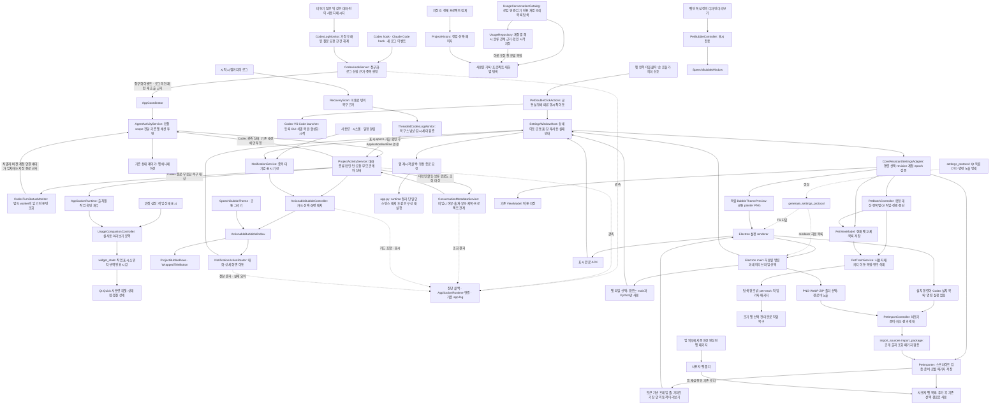

# 말풍선 구조와 유지 기준

기준일: 2026-10-18. 커밋되지 않은 변경을 포함한 현재 작업 트리 기준이다.
이 문서는 말풍선 변경 시 따라야 하는 구조 계약이다. 작업 지침은 개발 저장소의 `AGENTS.md`에 있다.

- **필수 구조 규칙:** 2절의 책임 경계와 7절의 보존 규칙. 일반적인 버그 수정·외형 변경에서 함께 바꾸지 않는다.
- **변경 가능한 정책:** 3~6절의 표시량·시간·주기·기본값. 사용자 요구에 따라 변경하되 코드·문서·회귀 테스트를 함께 갱신한다.
- **선택적 정리:** 7절 마지막의 리팩터링 후보. 아직 적용되지 않은 사항이며 현재 동작으로 해석하지 않는다.

구조 규칙 자체의 변경이 필요한 요구는 해당 규칙과 영향을 명시해 변경한다. 이미 승인된 사용자 요구를
이 문서 때문에 다시 승인받지 않는다. 변경 절차와 검증 책임은 8절을 따른다.

## 1. 기능의 큰 틀

말풍선은 프로젝트 작업 상태와 일반 알림을 펫 주변에 표시하고, 해당 대화나 상세 화면으로 이동하게 하는 UI다.
펫 애니메이션 상태, 프로젝트 활동 상태, 알림 전달 상태는 서로 다른 모델이다.

실행 시 `DesktopPet.setup_bubble()`이 기본 `PetBubbleController`를 만들지만,
`ApplicationRuntime`이 이를 `ActionableBubbleController`로 교체한다.
따라서 일반 실행의 동작 기준은 `actionable_bubbles.py`이며, 기본 제어기는 공통 설정·숨김·미리보기와 단순 말풍선 호환 경로를 제공한다.
`speech_bubble.py`는 분리된 모듈을 다시 내보내는 공개 API다.
펫 단독 구성의 `PetRuntime`은 기본 제어기를 유지해 디자인 미리보기만 제공한다.
비서 상태 입력과 실사용 알림은 생성하지 않는다. 두 구성 모두 앱 자체의 안내 세 가지(업데이트 설치 직전 "곧 다시 켜집니다",
자동 확인이 찾은 새 버전, 업데이트 뒤 첫 실행의 "정보에서 새로운 기능 보기")는 `CoreSettingsAdapter`가 미리보기 경로로 짧게 보인다.
새 버전 안내와 업데이트 뒤 안내는 `PetViewModel.announce`를 거쳐 말풍선 끄기·일시 중지·펫 숨김 중에는 보이지 않고,
버전마다 한 번만 보이며 복귀 뒤 다시 재생하지 않는다(BA-07). 업데이트 뒤 안내는 마지막 실행 버전(`updates/lastLaunchedVersion`)보다
현재 버전이 높을 때만 시작 몇 초 뒤 보이고, 새 설치·같은 버전·낮은 버전에서는 버전만 기록한다. 실행 기록이 없던 0.15.6 이하에서
올린 경우는 업데이트 확인 기록(`updates/lastCheck`·`updates/announcedVersion`)이 있으면 업데이트로 본다. 이 말풍선은 누를 수 없다. 공통 표시 값 `BubbleNotice`와
출처 표시 문구는 `ui/bubble_models.py`에 두어 펫 UI가 비서 상태 모듈을 import하지 않는다.

실제 연결은 `application/runtime.py`, `application/coordinator.py`, `features/agent_activity/service.py`에 있다.
`ActionableBubbleController.apply()`는 기존 애니메이션 presentation의 notice를 그대로 표시하지 않고 서비스 상태로 다시 렌더링한다.
복구 스냅샷은 `ProjectActivityService.restore_activity()`에 직접 전달한다. 일반 시작 이벤트·
`AgentActivityService`·펫 애니메이션 경로로 재전달하지 않는다. 복구 이후 새 활동은 일반 이벤트 경로를 따른다.

Codex 관리 hook의 Windows 명령은 `integrations/codex_install.py`가 명시적인
`powershell.exe -EncodedCommand` 호출로 만든다. UTF-16LE로 인코딩한 스크립트가 경로·인자를
단일 인용하고 호출 연산자 `&`로 실행하므로, 바깥 셸이 PowerShell 또는 cmd여도 경로의
공백·한글·특수문자가 재해석되지 않고 원래 JSON 표준입력을 브리지에 전달한다.
개발용 관리 스크립트와 배포본 브리지에 같은 생성 규칙을 쓰며, 일반 `command`의 관리 표식으로
기존 설치·복구·제거 식별을 유지한다. 이벤트 정규화·중복·상태 소유권은 바뀌지 않는다
(BA-01·BA-02·BA-08·BA-09·BA-10).
브리지의 종료 코드 0은 전달 성공 판정이 아니다. `hook-health.json`은 실행마다 마지막 한 건으로
덮어쓰며, 개발용 프로젝트 기록과 사용자 전역 기록을 구분해야 한다. `delivered`는 IPC 응답,
`queued`는 대기열 저장을 뜻한다. 실제 연결 검증은 같은 대화·턴의 수신 이벤트와
`named_pipe`·`workspace_queue` 경로를 대조하고, `codex_jsonl` 수신과 구분한다.
IPC 응답은 출처 차단·중복·서비스 상태 반영 성공까지 보장하지 않는다.

Claude Code 관리 hook은 `integrations/claude_code_install.py`가 exec 형식(`command`+`args`)으로 등록한다.
Claude Code가 셸 없이 브리지를 실행하므로 Git Bash가 없어 PowerShell로 물러나는 환경에서도 경로가 재해석되지 않는다.
exec 형식이 없는 status line은 일반 문자 경로면 따옴표 없는 명령을, 아니면 Codex와 같은 `-EncodedCommand` 호출을 쓴다.
관리 표식은 `args` 또는 디코드한 스크립트에서 찾으며, 이벤트 정규화와 상태 소유권은 바뀌지 않는다(BA-01·BA-08·BA-10).

Claude Code hook은 같은 hook 브리지와 `CodexHookServer`를 거쳐 source `claude_code`로 들어온다(13단계).
`ProjectActivityService`는 Claude Code 세션도 카드로 만들되 대화 키에 `claude_code:` 접두어를 붙여
같은 원본 ID의 Codex 대화와 섞지 않는다. Claude Code 이벤트에 대해서는 항상 수용을 반환해, 카드의 거부·중복
판정이 이미 검증된 펫 상태 반영을 막지 않는다(Codex는 기존처럼 카드 판정이 펫 전달을 거른다).
예외는 압축 이벤트다. 턴 사이의 수동 `/compact`에는 `Stop`이 오지 않으므로, 카드가 열린 턴에 붙인 압축만 펫에 넘기고
턴이 끝났거나 백그라운드 대기 중인 세션의 압축은 펫에 넘기지 않는다.
Claude Code는 중단·권한 거절·패널 닫기 때 종료 이벤트를 보내지 않는다. 중단·거절은
`integrations/claude_code_transcript.py`가 작업 중인 세션의 대화 기록에 hook 없는 사용자 텍스트 줄이
추가된 것을 확인해 `cancelled` 이벤트(전송 경로 `claude_code_transcript`)로 `CodexHookServer`에 넘긴다.
백그라운드 명령 결과를 읽으려고 Claude Code가 스스로 쓰는 사용자 줄(`promptSource: system`, `turnOrigin: task_notification`)은 중단·거절로 보지 않는다. 그 턴은 `UserPromptSubmit` 없이 새 `prompt_id`로 시작하므로, 이미 대체된 턴이 아닌 처음 보는 턴의 주 세션 `Stop`·`StopFailure`는 열린 턴의 완료로 받는다. 대체된 턴의 늦은 이벤트는 그 앞에서 거부되므로 새 턴을 끝내지 않는다(BA-02, 14단계). 이 턴의 도구 이벤트도 같은 규칙으로 열린 턴에 속한다.
깨울 백그라운드 작업(명령·하위 에이전트·종류 미상)이 남은 `Stop`은 브리지가 `background_wait`(작업 개수만)로 바꿔 보낸다. 감시용 작업(`monitor`, MCP 작업)과 끝난 작업은 세지 않는다. 카드는 `background` 상태로 `백그라운드 N개`를 보이고, 펫 세션은 `idle`로 남아 작업 중 집계에서 빠지며 알림을 내지 않는다. 완료 기록은 결과를 읽는 턴의 `Stop`에서 한 번만 만든다.
줄 종류와 세션 제목만 읽고 그 밖의 내용은 보관하지 않는다. 남은 경우는 출처별 무활동 만료(작업 중 10분, 확인 대기 30분,
설정창에서 변경)로 해제한다. 끝나지 않은 도구 호출이 있는 동안은 긴 도구가 이벤트 없이 돌 수 있으므로 확인 대기 시간을 쓴다.
부모 세션은 하위 에이전트가 일하는 동안 이벤트를 보내지 않으므로 하위 에이전트 이벤트가 부모의 마지막 활동 시각도 갱신한다.
같은 `InactivityLimit`과 두 규칙을 `state/session_manager.py`(펫)와
`ProjectActivityService`(카드 행)가 각각 적용한다. 이 만료는 완료·결과·알림의 표시 기한과 별개다(BA-04).

언어팩은 표시 문구만 제공한다. 팩 → 공통 번역기 → 설정·트레이·말풍선·위젯 경로와
상태줄 표시 사전은 [언어팩 구조](localization-architecture.md)를 따른다. 상태·수명·ID를 번역하지 않는다.

## 2. 책임과 수정 위치

| 책임 | 현재 구현 | 이곳에서 결정하지 않을 것 |
|---|---|---|
| 펫 외부 자산 입력·로컬 등록 | `pet/import_sources.py`는 두 공개 출처와 읽기 전용 Codex 목록, `pet/import_package.py`는 경로·크기·지원 정보·장식 검증, `pet/importer.py`는 식별자·준비·원자적 저장 | 명령 실행·Codex 설정 수정·활동 이벤트 생성 |
| 비동기 펫 준비·가져오기 미리보기 | `application/settings_ui/pet_import.py`는 한 worker·취소·작업 ID, 설정 어댑터는 준비 결과 수용·기한·등록 신호, React는 토큰으로 받은 프레임 줄 재생 | 실제 펫 상태·알림·테마 선택 변경 |
| 언어팩 검증·표시 문구·불변 사전 전달 | 공통 localization 모듈, application/localization.py, 설정 프로토콜과 host | 활동 상태·표시 기한·이동 대상 |
| 언어 적용을 위한 앱 재시작 | `application/restart.py`, `app.py`; host는 작업 중 거부와 콜백 호출만 담당 | 활동 상태 해석·복구 정책·표시 기한 변경 |
| 외부 이벤트 정규화·승인 주체 해석 | `state/events.py` | 카드 크기·배치 |
| 펫·비서가 공유하는 말풍선 표시 값, 출처 레이블, 출처 색 점(`SOURCE_MARK_TOKENS`) | `ui/bubble_models.py` | 상태 전이·알림 기한 결정 |
| 펫 아래 활동 문구(작업 중인 출처 이름) | `ui/activity_caption.py`, 출처 목록은 `state/presentation.py`의 `working_sources` | 출처별 세션 상태 해석 |
| 사용량 위젯의 출처별 작업 개수·표시 스위치·번역 문구 | `ApplicationRuntime._widget_activity`, `ui/usage_companion.py`, `usage/widget_state.py` | 활동 수집·상태 전이·완료 판정 |
| 사용량 위젯의 상태 점·펼친 상세 | `ui/usage_widget/window.py`, `ui/usage_widget/qml` | 작업 생성·수집·설정 저장 |
| 트레이 상태·프로젝트 메뉴·사용량 요약 | `ui/assistant_tray.py`, Codex 한도 요약은 `usage/presentation.py` | 활동 상태 생성·한도 데이터 수정 |
| 훅·로그 해석, 현재 턴의 새 도구 호출 근거 생성·내부 전달, 비동기 질문과 후속 사용자 메시지의 요청 ID 연결, 전달 중복 판정 | `integrations/codex_hooks.py`, `claude_code_hooks.py`, `claude_code_transcript.py`, `log_lifecycle.py`, `codex_log.py`, `codex_ipc.py` | 실제 카드나 펫 상태 직접 변경 |
| 복구할 미종료 턴의 근거 수집 | `integrations/activity_recovery.py`, `codex_log.py` | 복구를 현재 작업 중으로 확정하거나 완료 효과 재생 |
| 복구 스냅샷 전달·감시 세대/계정 경계 | `integrations/codex_log_worker.py` | 복구 행의 표시·만료 결정 |
| Codex 저장된 턴의 종료 근거 조회·본문 생략·조회 상한·계정/연결 세대 | `integrations/codex_turn_status.py`, 값 계약 `state/codex_activity.py` | 대화 재개·실행·구독, 미종료 상태를 현재 활동으로 추정 |
| 확정 scope를 펫 입력에 전달·Codex 관측 상태를 기존 펫 세션에 투영 | `features/agent_activity/service.py`, `state/session_manager.py` | 복구 행을 새 펫 세션으로 생성, 다른 출처의 상태 규칙 변경 |
| 대화 종류 확인·미확인 보관 상한, 턴 수명, 승인·동기 입력·비동기 질문의 대기 요청, 부모·자식 집계, 완료 기록, 출처별 대화 키·Claude Code 폴더 카드·무활동 해제 | `features/project_activity/service.py` | 글꼴·줄바꿈 |
| Claude Code 프로젝트 이름·해시(git 주 저장소 기준, 워크트리·하위 폴더 통합) | `integrations/claude_code_hooks.py`의 `project_identity`·`project_root`(hook 브리지와 대화 기록 공통) | 카드 수명·정렬 |
| 복구 근거 수용·저장 종료와 새 호출의 충돌 판정·현재 상태 전환·임시 행 만료 | `features/project_activity/service.py` | 원본 로그 스캔·과거 이벤트 재전송 |
| 읽기 전용 대화 신원 근거·제목·프로젝트 관계 보강 | `features/project_activity/metadata.py` | 수신 지연을 근거로 작업 완료 추정 |
| 사용량 기록의 제목·프로젝트 조회·갱신 일정 | `usage/conversation_catalog.py`, `application/settings_ui/assistant.py` | 활동 상태 변경·과거 이벤트 재전송·이름의 영구 저장 |
| 사용량 기록의 해시 프로젝트 분류 보관·복원·정리 | `storage/usage_repository.py`, 값 계약 `usage/conversation_models.py` | 이름·제목·원본 ID·경로 저장, 말풍선 상태·수명 변경 |
| Claude Code 작업 기록(대화 기록 파일의 턴별 토큰) | `usage/claude_code_transcripts.py`, `usage/claude_code_service.py`, `storage/claude_code_repository.py` | 말풍선 활동 상태 변경 |
| 사용량 프로젝트 집계·정렬·페이지 | `storage/usage_repository.py`, `usage/project_history.py` | Codex 또는 말풍선 프로젝트 순서 변경 |
| 알림 중복 제거·교체·대기열·표시 기한 | `features/notifications/service.py` | 프로젝트 작업 상태 |
| 도구 연결 감시(켜 둔 도구의 hook 풀림, 나중에 생긴 도구) | `features/integrations/watch.py`, 알림 제출은 `application/runtime.py` | 파일 복구·스위치 변경 |
| 카드 조립·선택·공간 축소·창 수명 | `ui/actionable_bubbles.py` | 이벤트의 의미 재해석 |
| 프로젝트 헤더·행·스크롤 | `ui/project_bubble_rows.py` | 상태 전이·완료 시간 |
| 제목 측정·최대 두 줄·말줄임 | `ui/wrapped_title_button.py` | 프로젝트 집계 |
| 공통 창·글꼴·외형·배치 계산 | `ui/speech_bubble_window.py`, `speech_bubble_paint.py`, `speech_bubble_decorations.py` | 알림 전달 정책 |
| 테마 정규화·자산·편집 | `pet/bubble_theme.py`, `ui/bubble_elements.py`, 미리보기 `ui/bubble_theme_preview.py`, 초안·미리보기 세대는 `settings-ui/src/core/useBubbleEditor.ts`, 표시는 `core/BubbleEditorDialog.tsx` | 실행 상태 변경 |
| 펫 패키지의 바깥 장식 검증·등록과 그리기 | `pet/bubble_frame.py`(로더가 `pet:<id>`로 등록), `ui/speech_bubble_frame.py` | 상태·표시 기한·배치 결정 |
| 펫·위젯 고정(클릭 통과)과 전역 단축키 | 펫 창 플래그는 `pet/window.py`, 버튼 말풍선은 `ActionableBubbleController.sync_click_through`, 위젯은 `ui/usage_widget/window.py`, 단축키 등록은 `integrations/windows_hotkeys.py`, 조립은 두 runtime의 `application/click_through.py` | 말풍선 상태·표시 기한·클릭 대상 변경, 고정 여부로 활동 상태 추정 |
| 펫 더블클릭의 설정 조회·명시적 이동 | `application/pet_actions.py`, 신호는 `pet/pointer_interaction.py`, 두 runtime이 생성·종료 | 활동·알림·애니메이션 상태 변경, 마지막 이벤트로 목적지 추정 |
| Codex·VS Code 앱 자체 열기 | 공통 창 찾기·복원·활성화·시작은 `integrations/windows_apps.py`, 등록 GUI 경로 조회는 `codex_launcher.py`(패키지·`codex` 처리기)와 `vscode_launcher.py`(`vscode` 처리기) | URL 이동·새 대화·세션 재개·수집 서비스 활성화, Claude Code 확장 링크 호출 |
| 공통 설정 홈 | `settings-ui/src/core/CoreHomePage.tsx`, App의 공통 페이지 컨테이너와 비서 홈 영역 합성 | 비서 정보 로딩을 이유로 공통 영역 숨김, 상위 훅·큐 재생성 |
| 클릭 대상 등록·검증·이동(출처별 대화 이동 방식 포함) | `features/notifications/actions.py`, Claude Code 실행 위치별 이동은 `integrations/claude_code_launcher.py` | 표시 문구에서 대상 추측 |
| 도구별 사용 스위치(관리 hook·사용량·수신·파일 읽기를 함께 켜고 끔), 한 번의 스위치 이전 | `features/integrations/activation.py`, 적용·서비스 시작/중지는 `application/runtime.py`, 꺼진 출처 수신 차단은 `integrations/codex_ipc.py` | 화면 숨김을 근거로 활동 상태 추정 |
| Electron 설정 명령·독립 미리보기·비서 응답 | `application/settings_ui/core.py`, `assistant.py`의 공통 진입점과 기능별 비공개 처리 메서드 | 상태 전이·표시 수명 재해석 |
| 설정 wire DTO·명령별 요청/응답·노출 구분 | Qt 독립 `settings_protocol.py`, `scripts/generate_settings_protocol.py`, TS·Electron 생성물 | 명령 실행·저장·계정 상태 소유 |
| 앱 업데이트 안내(설치 직전, 자동 확인이 찾은 새 버전, 업데이트 뒤 첫 실행) | `application/settings_ui/core.py`, 새 버전 확인 주기는 `application/update_check.py`의 `UpdateCheckSchedule`, 표시 조건은 `features/pet/viewmodel.py`의 `announce` | 활동·알림 대기열에 넣거나 끄기·일시 중지를 무시 |
| 다운로드한 펫 파일의 검증·준비·패키지 저장 | `pet/importer.py`, 공통 설정 어댑터와 Electron 파일 선택 | 비서 상태·알림 수명·웹 계정 연결 |
| 사용자 펫 삭제·휴지통·중단 복구 | `pet/trash.py`, 전환은 `features/pet/viewmodel.py`, 시작 복구는 `app.py` | 활동·알림 생성, renderer 파일 경로 수용, 기본 제공 파일 삭제 |
| 펫 다중 선택·일괄 작업 | `application/settings_ui/pet_batch.py`, 선택 UI는 `settings-ui/src/PetManagerDialog.tsx`·`usePetBatch.ts` | 비서 상태 생성, 전역 파일 경로 수용, 완료된 항목의 일괄 롤백 |
| 사용자 폴더의 완성된 펫 패키지 발견과 자산 로딩 | `pet/catalog.py`, `pet/loader.py`, 장식 등록은 `pet/bubble_frame.py` | 외부 설치 과정·현재 펫 선택·활동·알림 변경 |
| 설정창 프로세스·pipe·계정 epoch·알림 표시 ACK | `application/settings_ui/host.py`, `settings-ui/electron/` | 이동 요청 접수를 실제 표시 성공으로 간주 |
| 설정·적용/취소·알림 상세 화면 | `settings-ui/src/core/`, `assistant/`의 훅과 표시 컴포넌트. App이 공통 snapshot·명령 큐, `assistant/useNavigationAck.ts`가 표시 후 ACK 전송을 소유 | DB·계정 파일 접근, 실제 활동 상태 생성 |
| 표시 시간·저장 설정 | `bubble_timing.py`, `preferences/bubbles.py`, `pet/preferences.py` | 기존 표시의 기한을 임의로 다시 시작 |
| 활동·조회·표시·이동 진단 | `activity_diagnostics.py`의 공통 해시·실패 격리·변경 억제, 각 계층의 관측 콜백, `application/runtime.py`의 로거 연결·이동 실패 요약 | 진단 결과로 활동 상태·표시 기한 변경, 원문·제목·경로 기록 |

수집 계층은 정규화된 이벤트와 복구 근거를 만들 수 있지만 표시할 활동 상태의 최종 소유자는 서비스다.
UI의 `shown`·`named` 시각 보고는 관측이며 상태 전이가 아니다. 계층 간 신호 연결은 runtime/coordinator에 둔다.

사용량 기록의 제목 조회는 사용량 worker의 App Server 연결에서 별도로 수행한다. 기존 메타데이터 모듈의
로컬 프로젝트 인덱스 읽기·경로 정규화 함수와 제목 정제 함수만 공유하며, 말풍선 서비스 인스턴스나 활동
이벤트를 재사용하지 않는다. 이름은 계정·실행 세대에 묶인 메모리에만 보관하고 계정 초기화 때 비운다.
이는 BA-01·BA-02·BA-08·BA-09의 책임 경계를 유지하는 별도 읽기 경로다.

Codex 사용량의 계정·대화·프로젝트 해시 관계와 분류 근거·마지막 확인 시각은 DB v9에 보관한다.
계정 확인 후 사용량 조회는 저장 분류를 먼저 복원하며 프로젝트명·대화 제목은 보강 전까지 기존 대체 문구를 쓴다.
분류와 표시 이름은 별도 수명이다. 계정·연결 초기화는 메모리와 요청을 취소하지만 디스크 분류는 유지한다.
사용량 기록 삭제는 해당 계정의 분류도 삭제하고, 정기 보관 정리는 참조가 사라진 분류를 지운다.
DB 쓰기가 실패해도 현재 실행의 분류는 메모리에서 사용한다. Claude Code의 분류 저장 경로는 바꾸지 않는다.

사용량 worker의 catalog는 기록 모드 진입 시 시작하고 비활성화·계정 초기화·종료 시 정리한다.
기록 모드 동안 2초마다 로컬 인덱스의 변경 여부를 확인하며 관련 연결 정보가 바뀐 경우에만 갱신한다.
프로젝트 판정은 API 명시값 → 데스크톱 연결 → 명시적 프로젝트 없음 → 가장 구체적인 단일 루트 일치 순서다.
로컬 변경 뒤에는 이전 API 근거를 재검증하며 변경 전 시작한 응답이 새 연결을 덮어쓰지 않는다.
사용량 서비스의 새 작업·사용량 복구 근거에서 얻은 원본 ID는 보존 기록에 해당하는 것만 실행 중 기억한다.
이 ID의 `thread/read(includeTurns=false)`는 동시에 최대 2건, 정상 재검증은 5분 간격이다.
ID를 모르면 일반·보관 `thread/list`를 100건씩 번갈아 최대 100페이지 탐색하고 필요한 대화를 찾으면 멈춘다.
같은 목록 페이지와 로컬 인덱스의 분류 갱신은 각각 한 트랜잭션으로 저장한다.
개별 조회가 명시적으로 미지원이면 같은 제한의 목록 탐색으로 보완한다. 프로젝트 조회는 대화 조회를 막지 않으며
최대 1,000개·100페이지다. 각 요청은 10초 제한, 실패 재시도는 30초부터 최대 5분까지 늘린다.
수동 새로고침은 간격을 무시하되 같은 요청은 합친다. 화면 재진입·정렬·검색은 기존 조회 상태를 재사용한다.
조회 실패·정보 누락·목록 부재는 확정 분류를 삭제하지 않는다. 계정·연결 세대와 삭제 전 요청 경계를 검증한다.
이 변경은 BA-01·BA-02·BA-07·BA-08·BA-09를 보존하며 BA-10에 따라 문서와 회귀 검사를 함께 갱신한다.

Codex와 Claude Code는 도구마다 "사용" 스위치 하나를 둔다(ADR 0006). 저장 키는 `usage/enabled`(Codex)와
`usage/claude_code_enabled`(Claude Code)이며 서로 계승하지 않는다. Claude Code는 값이 없으면 꺼짐이다.
켜면 `features/integrations/activation.py`가 그 도구의 관리 hook 설치와 사용량 스위치를 함께 적용한다.
hook이 막혀도(Codex `[features].hooks = false`, Claude Code `disableAllHooks`·정책·잘못된 파일) 스위치는 켜고
경고만 보인다. Codex는 hook 없이도 로그로 활동을 받는다. 끄면 관리 hook(Claude Code는 관리 status line 포함)을
지우고, 파일 변경이 막혀도 스위치는 끈다. 검토 뒤 파일이 바뀌면 스위치를 저장하지 않고 다시 검토하게 한다.
`application/runtime.py`가 결과를 받아 꺼진 출처를 `CodexHookServer.set_source_enabled`로 막는다. 이 차단은
pipe·spool·JSONL·transcript 네 경로가 모두 지나는 `_deliver_payload` 맨 앞에서 하므로, 남은 hook의 이벤트는
펫·카드·알림·transcript 조회에 닿지 않는다. 끌 때는 그 출처의 펫 세션과 프로젝트 카드를 지운다
(`ProjectActivityService.reset(source)`; Codex 계정 세대는 Codex를 지울 때만 바뀐다). 이것은 말풍선 끄기·일시
중지·미리보기와 다른 입력 경계 변경이다(BA-07). 저장된 사용량·작업 기록은 지우지 않고 기록 목록에서만 뺀다.
Codex를 끄면 로그 tail, 계정 확인(`AccountMonitor`), 대화 메타데이터 worker, 진단의 Codex 파일 읽기, 시작 시
"Codex 미감지" 안내가 멈춘다. 사용자가 설정에서 명시적으로 고른 더블클릭 앱 열기는
수집 스위치와 독립적이며 꺼진 도구의 수집·계정 조회를 켜지 않는다. Claude Code를 끄면 사용량 서비스와 `settings.json` 상태
확인(출처 점·사용량·연결 화면)이 멈춘다. 꺼진 도구는 폴더가 있는지만 본다. 처음 실행할 때 한 번
(`internal/toolActivation`) Claude Code 스위치를 이 앱의 관리 hook·status line 유무로 다시 정하고 Codex 값은 둔다.
worker는 출처별 서비스에만 켜기·끄기를 전달하며, ViewModel은 꺼진 출처의 한도를 표시 스냅샷에서 제외한다
(BA-01·BA-07·BA-10).
홈과 사용량 현황의 한도는 Codex와 Claude Code의 별도 영역으로 표시한다.
reserve는 `base_model_inference` 또는 서버 한도 이름의 `reserve`로 식별하고 Codex 그룹 안에서
일반 한도 다음 마지막 카드로 표시한다. 분류는 `usage/models.py`, DTO 전달은 `application/settings_ui/assistant.py`,
화면 배치는 `settings-ui/src/AssistantPages.tsx`가 맡는다. 두 출처 중 하나만 켜져도 사용량 위젯을
유지하며 해당 출처의 행만 표시한다. 두 출처가 모두 꺼지면 위젯을 숨긴다.

사용 스위치는 연결·진단 화면에만 있다. 켜기·끄기는 `integration.preview`의 `enable`·`disable`로 바뀌는 내용을
먼저 보여 주고 `integration.apply`로 적용한다. 취소하면 파일과 스위치를 유지하며 다른 도구는 바꾸지 않는다.
켜진 도구에서만 hook 복구(`repair`)와 Claude Code status line 연결·해제를 받는다. 꺼진 도구는 홈·사용량·기록·
추세·트레이·위젯에서 숨긴다. Windows 설치기의 Codex·Claude Code 선택은 앱을 띄우지 않는
`--configure-integrations` 모드(`application/integration_setup.py`)로 같은 스위치를 적용한다. 지정하지 않은
도구는 그대로 둔다. 업그레이드의 처음 선택은 앱의 스위치를, 이전이 없던 설정이면 관리 hook 표식을 따른다.
무인 새 설치는 `/CLAUDECODE=on`이 없으면 Claude Code를 끈다(BA-01·BA-07·BA-10).
Claude Code를 켜면 한도를 받는 관리 status line도 함께 연결한다. hook과 status line이 같은 `settings.json`을
고치므로 앞 단계가 파일을 쓰면 다음 단계는 그 파일로 다시 계획한다(`ToolActivation.apply`).

연결 감시(`features/integrations/watch.py`)는 시작 5초 뒤와 10분마다, 연결 화면의 상태 갱신 뒤에 검사한다.
켜 둔 도구의 폴더가 있는데 hook이 `not_installed`·`partial`·`drifted`·`invalid`이면 `broken`이다. 사용자나
정책이 그 도구 설정에서 hook을 끈 `disabled`·`blocked_by_policy`와 사용자가 바꿀 수 있는 status line은 보지
않는다. 꺼 둔 도구의 폴더가 처음 확인 뒤에 생기면 `found`다. 첫 검사는 이미 있는 도구를
`integrations/knownTools`에 기록만 한다. runtime은 새 alert를 시스템 알림(교체 키 `connection:<도구>`, 이동
대상 `diagnostics`)으로 제출하고, 트레이 메뉴 첫 줄과 설정 홈의 `연결` 행은 감시 snapshot을 읽는다.
`broken`은 실행마다 한 번, 회복 뒤 다시 풀리면 한 번 더 알리고, `found`는 한 번만 알린다. 이 알림은 일반
알림 대기열·숨김 규칙을 그대로 따르며 활동 상태를 바꾸지 않는다(BA-01·BA-03·BA-07).

사용량 기록의 프로젝트 정렬·선택은 `usage/project_history.py`가 맡고, 저장소가 전체 보존 기록의
프로젝트 요약을 먼저 집계한 뒤 프로젝트·대화·작업을 각각 100건씩 전달한다. UI는 카드 목록을
증분 갱신하며 숨긴 기록 탭에서는 최신 스냅샷만 보관한다. 계정 전환 시 이전 선택과 상세는 즉시
비운다. 사용자 지정 순서는 이 앱의 계정별 설정이며 말풍선이나 Codex 프로젝트 순서를 변경하지 않는다.
사용량 기록의 공통 제목 줄 오른쪽에는 좁은 화면의 목록·상세 전환 버튼을 둔다. 유효한 대화 선택이
없으면 버튼을 숨기고 전환도 차단한다. 선택 응답을 기다리는 동안 목록에 머물며 일치하는 응답에만
상세를 연다. 선택 요청 실패·30초 응답 지연은 목록 안내로 표시하고, 계정 전환·기록 삭제는 대기 중인
전환 의도와 타이머도 취소한다. 검색·정렬 도구는 제목 아래 공통 행에 두고 검색은 왼쪽, 정렬은
오른쪽 끝에 맞춘다. 좁은 너비에서는 정렬 묶음만 다음 줄 오른쪽으로 내린다. 출처·상태와 표시 범위·
프로젝트 개수는 공통 하단의 좌우에 두고 페이지 버튼은 필요한 경우에만 그 위에 표시한다.
프로젝트 이동 버튼은 사용자 지정 정렬에서만 프로젝트 선택란 옆에 표시한다. 이 표시 정책은 BA-05·BA-06의
선택·스크롤 유지 원칙을 따르며 조회·정렬 데이터 계약은 바꾸지 않는다.

두 구성의 펫 더블클릭 기본값은 손 흔들기와 설정창 홈 열기다. 앱 공통 설정
`pet/doubleClickAction`은 `settings_home`·`codex`·`claude`·`wave_only`를 허용한다. `claude`는
Claude Code가 실행되는 VS Code의 가장 앞 창을 그대로 앞으로 가져오고, 창이 없으면 VS Code를
인자 없이 시작한다. 확장의 `/open` 링크(세션 없이 호출하면 매번 새 대화 탭을 만든다)와
마지막 hook 이벤트에 따른 세션·폴더 선택은 쓰지 않는다. 입력 제어기는 손 흔들기와 의미 신호만
담당하고 두 runtime의 공통 `PetDoubleClickActions`가 클릭 시 설정을 조회한다. 앱 종료 시
신호 연결을 해제하며 별도 선택 상태나 작업 대기열은 없다. 앱 활성화 실패는 홈과
설정 호스트의 오류 안내로 표시하고 작업 말풍선을 미리보기로 덮지 않는다.

펫·위젯 고정은 창의 입력 통과 플래그(`WindowTransparentForInput`, Windows `WS_EX_TRANSPARENT`)만
바꾼다. 일반 말풍선은 원래 클릭을 받지 않는다. 버튼 말풍선은 `pet/clickThroughBubbles`를 켠 경우에만
펫 고정을 따라 통과하며, 이때도 카드 내용·표시 기한·클릭 대상·스크롤은 그대로다(BA-06). 새로 만드는
카드 창은 생성 시점의 고정 상태를 받는다. 고정을 켤 때의 안내 말풍선은 일반 미리보기 경로를 쓰고
작업 상태를 바꾸지 않는다(BA-07). 고정 상태와 단축키는 앱 공통 설정(`pet/clickThrough*`,
`usage/widgetClickThrough*`)이라 펫을 바꿔도 유지된다.

홈은 현재 펫·꾸미기 바로가기·더블클릭 요약의 공통 영역과 선택적인 비서 영역을 합성한다.
공통 영역은 비서 데이터 실패와 무관하게 표시한다. 페이지 이동은 기존 상위 훅·단일 설정 큐와
초안·필터 상태를 유지한다. 펫 이미지는 기존 미리보기 조회를 홈 표시 시에도 사용하며
펫 단독에서 비서 snapshot을 요청하지 않는다(BA-01·BA-06·BA-07·BA-10).

## 3. 카드 종류와 표시량

사용량 서비스가 같은 계정의 일반 갱신 알림을 확인한 경우 기존 연결을 유지하며
메타데이터·프로젝트 활동의 계정 경계 신호를 발생시키지 않는다. 실제 계정 변경과
인증 파일 교체로 연결을 갱신할 때만 기존 runtime 경로에 전달한다.
동일 계정의 인증 파일 교체는 실제 계정 전환 초기화와 구분한다(BA-01·BA-09).

| 종류 | 묶음·구성 | 표시 제한 |
|---|---|---|
| 프로젝트 카드 | 프로젝트명 + 상태 집계 / 대화 제목 + 상태 배지 / 초과 프로젝트 안내 | 최대 3개 카드 |
| 일반 알림 | 사용량 또는 시스템 / 메시지 / 내용 확인 / 대기 건수 | 일반 대기열에서 1개 |
| 일정 알림 | 일정 / 메시지 / 내용 확인 / 대기 건수 | 일정 대기열에서 1개 |

충분한 화면에서는 합계 최대 5개다. 기반 제어기의 `MAX_VISIBLE_BUBBLES = 3`을 전체 실사용 카드 상한으로 해석하면 안 된다.
프로젝트 카드가 먼저 오며 확인 필요·실패 카드가 우선한다. 일반 알림 다음에 일정 알림이 온다.

한 프로젝트 안의 대화는 기본 두 행 높이의 스크롤 영역에 모두 들어간다. 두 대화만 보관하는 구조가 아니다.
화면이 좁으면 프로젝트 영역을 한 행 높이로 줄이고, 그래도 부족하면 뒤쪽 카드를 제외한다.
헤더 집계는 스크롤 밖의 대화까지 포함한다.

프로젝트 없는 대화는 별도 공통 카드로 묶는다. 프로젝트 정보 미확정은 이와 구분하고,
사용자 대화의 주 작업임이 확인되면 이름 조회를 기다리지 않고 `프로젝트 확인 중` 카드로 묶는다.
일반 Codex hook은 하위 에이전트 이벤트가 아니라는 이유로 주 대화임을 확정하지 않는다.
일반 hook의 scope는 `unknown`이며, 이전 브리지·대기열의 `main`도 로그 근거가 없으면 미확인으로 받는다.
저장된 세션 로그의 주 에이전트 출처 또는 동일 ID의 `thread/read(includeTurns=false)` 응답에서
`ephemeral=false`·지원하는 주 출처·부모 없음이 확인되어야 독립 주 대화로 표시한다.
API의 `subAgent`·`threadSpawn`과 로그의 `subagent`·`thread_spawn`을 모두 해석한다.
`ephemeral=true`와 내부 에이전트 출처는 내부 세션, 명시적 부모·spawn 출처는 하위 에이전트로
구분한다. 내부·자식 근거가 주 대화 근거보다 우선하며 제목·프로젝트 연결만으로 승격하지 않는다.
필드 누락·새 출처·조회 실패(`-32600` 포함)는 미확인으로 남기고 기존 백오프로 재조회한다.
목록에 없다는 사실이나 제목·프로젝트가 없다는 사실로 내부 세션을 확정하지 않는다.
미확인 상태에서도 턴·도구·질문 관계는 수집하되 카드·설정창 알림 기록·펫 집계·일시/지속 알림과 효과에서
제외한다. 정상 대화로 확인되면 현재 활동을 기존 펫 세션에 투영하며 과거 시작·완료 효과는 재생하지 않는다.
미확인과 내부 세션의 대기 요청도 펫의 지속 알림을 만들지 않는다. 확인된 자식의 기존 부모 집계는 유지한다.
프로젝트 식별은 API의 명시적 프로젝트 ID → 데스크톱의 대화별 연결 → 명시적 프로젝트 없는 대화
순서로 확인한다. 셋 모두 없으면 대화의 작업 폴더와 등록된 로컬 프로젝트의 `rootPaths`를
Windows 경로 기준으로 비교한다. 작업 폴더를 포함하는 가장 구체적인 루트가 단일 프로젝트에
속할 때만 연결하며, 같은 루트에 여러 프로젝트가 있거나 절대 경로가 아니면 미확정으로 둔다.
폴더 이름만 같은 경우와 경로 접두어만 겹치는 경우는 연결하지 않는다. 이 규칙은 응답 처리와
주기적인 관계 갱신에 공통 적용하며, 작업 폴더 캐시는 대화 등록 해제·계정 초기화 때 비운다.
자식 활동은 부모 대화에 합산하며, 부모가 확인되지 않은 비주 활동을 독립 프로젝트 작업처럼 표시하지 않는다.

Claude Code에는 프로젝트 API가 없으므로 이벤트 처리에서 메타데이터 조회 요청 신호를 내지 않는다.
기존 `refresh_active`의 주기 등록은 출처 공통 경로라 Claude 세션도 Codex 조회 대상으로 포함될 수 있다.
이번 진단 보강은 그 대상의 출처를 기록하며 조회 대상을 바꾸지는 않는다. hook 브리지가 이벤트의 작업
폴더(cwd)에서 폴더 이름과 정규화한 전체 경로의 SHA-256 앞 16자리만 계산해 보내고, 전체 경로는 앱·로그·DB로
보내지 않는다. 카드 키는 `project:claude_code:<해시>`, 카드 이름은 폴더 이름이다. 대화 제목은 대화 기록의 `custom-title`(사용자가
붙인 이름)을 먼저, 없으면 `ai-title`을 쓰고, 둘 다 없으면 `Claude Code 대화`다. 제목은 작업 중인 세션을 감시할 때
파일 끝 256KiB와 새 줄에서만 읽고 메모리(최대 512개)에만 두며 로그·trace·DB에 넣지 않는다.
Codex 계정 전환 초기화(`ProjectActivityService.reset()`, 펫 세션 정리)는 Codex 상태만 지우고 Claude Code
카드·완료·펫 세션은 유지한다.
세션의 첫 이벤트에서 받은 폴더로 고정하고 이후 cwd가 달라져도 옮기지 않는다. 폴더 정보가 없는 최소 이벤트는
`unassigned:claude_code` 카드로 묶는다. 하위 에이전트 이벤트가 부모보다 먼저 와도 같은 폴더 값으로 부모의
카드를 채워 `프로젝트 확인 중`으로 보내지 않는다. 같은 폴더를 Codex와 함께 써도 카드를 합치지 않는다.
카드 제목은 출처와 관계없이 폴더 이름만 쓴다. 출처는 Claude Code 연결(hook 설치)과 Codex 계정 확인이 둘 다
참일 때만 머리글 칩 왼쪽의 색 점(Codex `source-codex`, Claude Code `source-claude-code`)으로 표시하고, 한 도구만
쓰면 표시하지 않는다(14단계). 점은 칩의 왼쪽 여백에 그려 제목을 평문으로 유지하므로 머리글 폭·말줄임 측정은
바뀌지 않는다(BA-05). 출처 이름은 툴팁·접근성 이름에 넣는다. 짧은 알림 칩은 같은 조건에서 `Codex ·`·`Claude Code ·`
글자 대신 점을 쓰고, 일정·비서 같은 다른 출처는 글자로 둔다. 표시 여부는 `ApplicationRuntime._update_source_marks`가
정해 말풍선 컨트롤러와 트레이에 넘기며, 카드에서는 `CardContent.mark`로 전달되어 기존 변경 감지를 그대로 탄다.
트레이 진행 중 프로젝트 메뉴는 같은 조건에서 항목에 색 점 아이콘을 붙인다. Electron `알림·기록`과 홈은 넓은 화면이므로
출처 이름 앞에 같은 색 점을 붙여 늘 표시한다.

트레이의 `Codex 사용량`은 `codex` 한도의 기본·추가 구간 중 확인 가능한 잔여율의 최솟값을 표시한다.
별도 `gpt-reserve` 한도로 Codex 값을 대체하지 않는다. Codex 한도가 있지만 두 구간 모두 미확인이면
`확인 불가`다. `codex` 항목 자체가 없는 응답은 제공된 다른 한도의 두 구간에서 확인 가능한 최솟값을
사용한다. 이는 표시 요약 정책이며 서버의 한도·사용량 위젯·상태 해석을 변경하지 않는다(BA-01·BA-10).

활동 로그는 250ms마다 확인하며 새 `task_started`는 후속 활동 기록을 기다리지 않고 전달한다.
사용량·과거 이력은 별도로 750ms 주기를 유지한다. 메타데이터는 새 작업·소속 미확정 작업을
우선 조회하며, 동시 요청 4개 중 정기 갱신은 최대 2개만 사용한다. 진행 중 대화는 3초,
완료 카드는 15초마다 API 정보를 갱신하고 로컬 프로젝트 연결은 1초마다 확인한다.

재시작 시 최근 10분 이내 수정된 추적 로그(최대 128개)를 최신 순으로 조사한다. 복구 스캔은
시작 시점의 파일 끝을 기준으로 회당 20ms·1MiB·2,000개 기록까지 처리하고 실시간 활동에
양보한다. 복사된 이력과 종료된 턴을 제외한 최근 미종료 작업은 `상태 확인 중`으로 복구한다.
새 활동이 확인되면 현재 상태로 전환하고, 60초 동안 확인되지 않으면 복구 행을 제거한다.
복구는 일반 이벤트와 별도 스냅샷으로 전달하므로 과거 시작·완료 효과나 이력을 재생하지 않는다.
감시 세대·계정 경계와 새 이벤트가 오래된 복구 결과보다 우선한다. 메타데이터 API의
`notLoaded`는 실제 Desktop 실행 여부의 근거로 사용하지 않는다.

지연 진단은 감지·조회 대기·조회 시작·응답·최초 표시·이름 확정 시각을 메모리에만 보관한다.
대화당 최신 감지 건을 최대 512개·10분 보관하며 본문과 도구 내용은 포함하지 않는다.

일반 실행은 `activity_diagnostics_enabled`의 `phase=minimal`을 기록하고, 활동 생성·턴 교체·상태·
부모·프로젝트 변경, 복구·만료·무활동·초기화·완료 닫기, 조회 실패와 복구, 카드 포함·표시 변경,
클릭 요청과 전달 결과를 기존 `app.log`에 남긴다. 수집의 `activity_input`에는 전송 경로와
범위 보정 전(`incoming_scope`)·로그 근거(`known_scope`)·최종 범위(`scope`)를 구분한다.
heartbeat·일반 도구 왕복·변경 없는 정상 조회·펫 이동·반복 렌더링만으로 최소 로그를 늘리지 않는다.
`WATCHED_KETTLE_TRACE_ACTIVITY=1`은 중복·거부까지 포함한 모든 수집 이벤트와 개별 조회 요청·응답을
추가 기록한다. 이 모드는 상태 처리나 조회 정책을 변경하지 않는다(BA-01·BA-02·BA-08·BA-09).
부모·자식 합산의 `activity_aggregated`는 루트·선택된 활동 해시와 구성원 수·최종 상태가 바뀔 때만 기록한다.

대화·턴·요청·부모·프로젝트·카드 키는 SHA-256 앞 10자리로만 기록한다. Claude 대화·부모는
수집·서비스·UI 모두 `claude_code:` 접두어를 적용한 동일 해시를 쓴다. Codex 대화 해시는 기존과 같다.
제목 존재·프로젝트 확정은 불리언으로, 프로젝트 결정 근거와 실패는 고정 분류로 기록하며 제목·
본문·전체 경로·명령·URL·원본 오류 메시지·이동 토큰은 남기지 않는다. generation·epoch·등록 버전·
요청 번호로 조회와 오래된 응답 폐기를 연결한다. RPC 코드는 정수만 기록하며 `notLoaded` 등을
실제 실행 여부나 작업 종료의 근거로 사용하지 않는다.

같은 조회 실패는 최초 발생과 60초마다 누적 시도 수를 기록하고, 실패 종류 변경·복구는 즉시 기록한다.
복구 후 정보가 이전과 같아도 정상 조회 결과를 한 번 다시 기록하여 클릭 요약의 마지막 조회가
실패로 남지 않게 한다. 상세 모드에서 최소 기록과 같은 생명주기 이벤트를 중복 기록하지 않는다.
진단용 변경 억제·마지막 조회·진행 요청 해시·UI 포함·이동 대상 해시 캐시는 각각 최대 512개이며 넘으면 오래된 관측을
버린다. UI 관측이 상한에 잘리면 누락된 행을 실제 제거로 추정하지 않는다. 로그는 파일당 2MiB·백업
3개로 회전하고 기존 진단 ZIP에 포함한다. 로그와 캐시의 실패·만료·퇴출은 실제 활동·재시도·표시
기한·클릭 반환값을 바꾸지 않는다. 메타데이터 worker의 관측은 Qt 신호로 주 스레드에 전달하며,
서비스가 application 로거를 직접 import하지 않는다.
해시·결정 근거 등 진단 필드 준비와 로거 연결도 오류 격리에 포함하며 실제 결과 전달·대상 해제·완료 제거는 계속한다.
초기화·재연결로 실제 요청 목록이 비워져도 진단용 요청 해시는 늦은 응답까지 유지하여
`request_invalidated`와 원래 세대·epoch·등록 버전을 기록한다. 이 캐시도 상한을 넘으면 퇴출된다.

## 4. 상태와 시간

| 상태·상황 | 사용자 표시 | 수명 |
|---|---|---|
| 실행 | 작업 중 | 일반 표시 시간으로 종료하지 않음 |
| Claude Code 무활동 | (행 제거) | 마지막 이벤트(하위 에이전트 이벤트 포함) 뒤 작업 중 10분, 권한 요청·백그라운드 대기·끝나지 않은 도구 실행 중 30분(설정 가능). 완료·실패로 기록하지 않음 |
| Claude Code 권한 요청 | 권한 요청 | 같은 도구의 종료 이벤트, 다음 도구 이벤트 또는 턴 종료까지. 승인 시점에는 hook이 없어 승인 뒤 도구 실행 중에도 남으며, 배지 툴팁이 이를 알린다 |
| Claude Code 백그라운드 대기 | 백그라운드 N개 | 턴은 끝났지만 결과를 읽으러 다시 깨어날 백그라운드 작업(명령·하위 에이전트)이 남음. 펫은 작업 중 집계에서 빠지고 알림·완료 기록 없음. 결과를 읽는 턴의 도구 이벤트로 작업 중, 그 턴의 `Stop`으로 완료 |
| 검토 | 검토 중 | 일반 표시 시간으로 종료하지 않음 |
| 동기 사용자 입력·사용자 승인 대기 | 확인 필요 | 연결된 요청의 해소 또는 턴 종료까지 |
| 비동기 대화 질문 대기 | 확인 필요 | 같은 대화·턴의 다음 사용자 메시지 또는 턴 종료까지 |
| 자동 승인 심사 | 작업 중 | 사용자의 확인 대기로 승격하지 않음 |
| 승인 주체 미상 | 권한 처리 중 | 식별된 요청은 해당 요청의 해소·턴 종료까지. 요청 ID 없는 중립 표시는 같은 턴의 더 새로운 로그 도구 호출에서 해제하며 특정 요청과 연결된 것으로 추정하지 않음 |
| 일반 활동의 수신 지연 | 상태 확인 중 | 단순 지연만으로 행을 제거하지 않고 후속 이벤트로 회복 |
| Codex 종료 기록만 확인 | 종료됨 | 결과 표시 시간 기본 8초. 성공 강조·성공 기록 없이 읽기 전용 결과 확인 |
| 재시작 시 미확정 복구 | 상태 확인 중 | 복구 후 60초간 새 활동이 없으면 임시 행 제거; 완료로 기록하지 않음 |
| 컨텍스트 압축 | 컨텍스트 압축 중 | 기존 대화의 부가 표시이며 별도 완료가 아님 |
| 성공 완료 | 완료 | 강조 기본 15초, 완료 행 최대 300초 |
| 실패·중단 | 실패·중단 | 결과 표시 시간 기본 8초 |
| 일반·일정 알림 | 해당 알림 메시지 | 실제 처음 표시된 시점부터 기본 8초 |

완료 강조와 완료 행의 수명은 다르다. `completion` 설정은 강조 시간이며 300초의 행 유지 기한을 변경하지 않는다.
완료 행은 ×, 같은 대화의 새 작업 시작, 만료 또는 상태 초기화로 제거된다. 제목을 눌러 대화를 여는 것은 완료 닫기가 아니다.
완료 표시 대상은 주 에이전트의 성공이며, 늦게 온 이전 턴 결과나 자식 완료를 별도 주 작업 완료로 만들지 않는다.

대화의 확인된 scope가 `unknown`인 완료는 즉시 성공 표시를 만들지 않는다. 최초 완료 시각·기한과
로컬 활동 버전을 완료 후보에 보관한다. 턴 ID가 없는 hook도 같은 대화의 현재 활동에 연결하되,
식별자가 없는 종료로 이미 식별된 다른 턴을 끝내지는 않는다. 후보는 활동의 결과 표시 8초가 끝난 뒤에도
메타데이터 조회 대상에 유지한다. 300초 안에 정상 주 대화의 신원이 확인되거나 같은 대화·턴의
명확한 주 작업 완료가 도착하면 한 번만 발행한다. 다른 턴의 완료로 후보를 확인하지 않는다.
강조와 유지 기한은 최초 완료 시각 기준이며, 완료 애니메이션은 다시 재생하지 않는다.
이미 주 대화임이 확인된 대화는 후속 hook의 `unknown` 때문에 신원 확인을 잃지 않는다.
새 턴·초기화·계정 전환·만료·내부/자식 관계 확인은 이 후속 확인을 무효화한다. 이미 닫은 완료는 복원하지 않는다.

수신 지연 기준은 실행 60초, 도구 실행 180초, 압축 유예 600초다. 이는 작업 종료 기한이 아니라 상태 불확실 표시의 기준이다.
heartbeat가 없는 Claude Code는 긴 응답·도구 실행 중에도 이벤트가 끊기므로 이 기준으로 `상태 확인 중`을 표시하지
않는다. 무활동 만료 시간이 지나면 행을 제거하고 해당 대화를 닫힌 것으로 기억한다.
명시적인 사용자 대기는 단순 수신 지연으로 해제하지 않는다.
`request_user_input_async`의 즉시 반환하는 `accepted`는 질문 접수 결과이며 사용자 답변이 아니다.
다른 도구 활동과 같은 요청의 `PostToolUse`도 비동기 질문 대기를 해제하지 않는다.
로그에서 답변만 식별할 수 없으므로 같은 대화·턴의 다음 사용자 메시지마다 가장 먼저 열린
질문 요청 한 건을 해제한다. 답변과 무관한 사용자 메시지도 이 기준에 따라 처리된다.
질문·답변 본문은 수집하거나 저장하지 않는다. 재시작 복구는 기존 `상태 확인 중` 정책을 유지한다.
일반 활동의 불확실 표시와 재시작 복구의 재확인 만료는 문구만 같고 수명이 다르다.
복구 행이 새 유효 활동으로 확인되면 복구 전용 60초 기한을 해제하고 일반 활동 규칙으로 전환한다.

### Codex 종료 근거와 관측 경계

`task_complete`는 턴 종료이며 성공의 증거로 사용하지 않는다. `ended`로 정규화해 중립적인
`종료됨`을 표시하고, 같은 턴의 명확한 성공 hook 또는 저장된 턴의 종료 결과가 있어야 성공 완료를 만든다.
구조화 오류 코드는 사용량·요청·예산·컨텍스트 제한, 공급자 오류, 미상으로만 분류하며 오류 원문은
보관하지 않는다. 오류 단독 입력은 재시도일 수 있으므로 종료를 확정하지 않는다. `failed`의 확정 사유가
사용량 제한이면 `사용량 제한으로 중단`을 표시한다. Claude Code의 `Stop` 등은 기존 해석을 유지한다.

`CodexTurnStatusMonitor`는 별도 Qt worker와 기존 App Server 클라이언트로 `thread/turns/list`만 읽는다.
종료 미확정은 즉시, 활동 무응답은 기존 지연 기준, 사용자 대기는 60초 뒤 종료 여부만 조사한다.
복구 행도 즉시 조사할 수 있다. 동시에 1건, 대상 128개, 요청 10초, 재조회 최소 30초,
최신순 20턴씩 최대 2페이지(40턴)이며 `itemsView=notLoaded`로 본문을 받지 않는다.
종료 미확정을 우선하고 다른 대상은 순환한다. 메타데이터 조회와 독립적이며 대화를 재개·실행·구독하지 않는다.
대화·턴·활동 버전·계정 세대·연결 세대가 모두 일치하는 종료만 반영한다. `inProgress`, `notLoaded`,
누락·미지원·조회 실패로 실행·완료를 추정하지 않는다. 미지원 메서드는 재연결까지 조회를 멈춘다.
늦은 조회 결과는 최초 종료 시각의 강조·유지 기한을 보존하며, 조회 결과만으로 만료·닫기·새 턴 뒤 표시를 복원하지 않는다.
이미 종료된 행의 보강은 애니메이션을 재생하지 않고, 복구 행의 과거 종료는 행 정리만 한다.

저장 조회에 의한 종료와 실제 hook·로그의 종료는 구분한다. 저장 조회로 종료한 턴은 원래 활동과
판정 시각·세대·알려진 호출 ID를 복구 후보로 최대 4,096건 보관한다. 현재 로그 턴의 새 도구 호출이
종료 판정 이후에 기록됐고 대화·턴·호출·기록 시각이 모두 일치할 때만 해당 후보를 복구한다.
`CodexLiveToolStart`는 수집기가 현재 턴 연결을 검증한 뒤 정규화 경계를 지나 붙이는 내부 전용 값이다.
외부 hook·IPC JSON의 같은 이름 필드는 제거하며, 로그 전송 외 경로에서는 이 근거를 전달하지 않는다.
새 호출 판별 이력도 최대 4,096건이며 파일 추적 해제·수집 초기화 시 비운다. 요청 ID 누락은
내부의 빈 ID 슬롯으로 관리해 명시적인 `legacy` 등의 실제 ID와 충돌하지 않는다.
도구 반환·일반 heartbeat·제목 조회·중복 호출·과거 기록만으로는 복구하지 않는다(BA-01·BA-02·BA-08·BA-09).

복구 시 다른 요청의 대기는 보존하고 기존 상태·펫 투영 경로를 따른다. 과거 시작·완료 효과를 재생하지 않는다.
저장 종료와 새 호출이 충돌한 턴은 실제 종료 이벤트가 올 때까지 저장 조회로 재종료하지 않는다.
수신이 끊기면 기존 불확실 상태 기준을 적용하며 새 종료를 추정하지 않는다. 실제 종료 이벤트,
다른 턴으로의 교체, 계정·수집 초기화는 해당 복구 후보·충돌 기록을 폐기한다. 상한 초과 시 가장 오래된
후보부터 버린다. `stored_turn_resolution` 진단에는 해시와 판정 사유만 기록한다(BA-04·BA-09·BA-10).

heartbeat 생성 전에 레코드의 턴·도구 요청 연결을 확인한다. 이전 턴의 늦은 반환·종료는 새 턴의
관측 시각·활성 ID·질문·복구 근거를 변경하지 않는다. 파일 삭제는 해당 추적을 해제하고, 일시적 읽기 오류는
파일별로 격리해 다른 파일의 활동·사용량·복구 순회를 계속한다. 파일 오류 요약도 추적 상한 안에 둔다.
계정 전환은 로그 worker의 세대를 즉시 바꾸어 큐에 남은 활동·사용량·복구·진단을 차단한 뒤 새 파일 끝을
기준점으로 잡는다. 전환 뒤 과거 복구 효과를 재생하지 않는다.

Codex 관측 상태는 프로젝트 서비스가 소유하며 `AgentActivityService`가 기존 펫 세션에만 투영한다.
불확실 상태는 작업 중 애니메이션·활성 개수·출처 문구에서 제외한다. 유효 heartbeat는 펫의 최근 확인
시각도 갱신하므로 12시간 일반 세션 정리와 어긋나지 않는다. 명시적인 사용자 대기는 보존한다.
Codex 내부 에이전트는 활성 개수와 사용자 알림에서 제외하며 실패도 진단에만 남긴다.
카드는 부모·자식을 합친 대화 단위, 펫 활성 개수는 불확실·내부 항목을 제외한 세션 단위다.

Codex 미확인 행의 툴팁은 마지막 확인 시각을 보이고 ×로 숨길 수 있다. 닫기는 현재 턴·활동 버전의
표시만 숨기며 종료 기록을 만들지 않는다. 제목 조회·재렌더링으로 복원하지 않고 실제 새 활동이나
새 턴에서 복귀한다. 자동 만료는 추가하지 않는다. 트레이 행과 말풍선은 같은 상태 레이블을 쓴다.
부모가 종료됐을 때 이미 불확실한 자식은 집계에서 제외해 부모 결과를 가리지 않으며 부모 결과 만료 뒤에도
그 오래된 행을 복원하지 않는다. 자식의 새 유효 활동은 다시 집계한다. 정상 활동·사용자 대기 중인 자식은 유지한다.

부모·자식 집계에서는 사용자 확인 요청을 최우선으로 선택한다. 그 외에는 정상 수신 중인 활성 항목들에
기존 상태 우선순위를 적용한다. 불확실한 활성 항목만 남을 때 `상태 확인 중`을 표시한다.
따라서 정상 작업 중인 부모 또는 자식을 오래된 다른 자식의 상태가 가리지 않는다.

`BubbleDurationPolicy`는 공통 8초와 `result`, `general`, `schedule`, `completion` 개별 설정을 제공한다.
설정 범위는 5~60초이고, 완료 강조의 미설정 기본값은 공통값과 독립적인 15초다.
설정창의 `개별 시간 사용`을 끄면 해당 재정의만 제거한다. 종류별 초기화는 네 재정의를
모두 제거하되 현재 공통 시간은 유지하며, 전체 시간 초기화는 호환 명령으로 별도 유지한다.
이미 생성된 결과·완료 기한과 이미 표시 중인 알림 기한은 설정 변경으로 연장하지 않는다.
아직 표시하지 않은 알림은 표시 시점의 설정을 사용한다.

카드 간 상태 우선순위와 카드 내부 행 순서는 별개다.
상태 집계는 확인 필요 > 실패 > 실행·검토·권한 처리 > 완료·중단 순이며,
행 순서는 완료 > 확인 필요·실패 > 중단 > 실행·검토·권한 처리 순이다.
동급 행은 상태에 해당하는 시각의 최신순과 대화 ID로 정렬해 heartbeat나 도구 이벤트만으로 순서가 흔들리지 않게 한다.
현재 헤더는 0건 항목을 생략하며 실패·중단 건수는 별도 합산 문구 없이 행 배지에서 표시한다.

## 5. 레이아웃과 외형

- 프로젝트 헤더는 프로젝트명과 집계를 한 줄로 유지한다. 테마 최대 너비보다 헤더가 길면 카드가 더 넓어질 수 있다. 실제 화면 너비도 넘을 때만 헤더 글꼴을 축소한다.
- 제목은 자연 너비만큼 카드를 먼저 넓히고 적용 가능한 최대 너비에 도달한 뒤 줄바꿈한다. 최대 두 줄 이후에는 말줄임한다. 원문은 툴팁과 접근성 이름에 남긴다.
- 너비 측정과 줄바꿈은 같은 `QTextLayout` 규칙을 사용하고 자연 너비를 올림한다. 정수 반올림으로 짧은 제목이 불필요하게 두 줄이 되는 회귀를 방지한다.
- 제목·상태 배지·완료 ×는 독립된 칸이다. 상태 칸이 짧아질 때 이전 고정 너비를 해제해 원래 크기로 돌아간다.
- 상태 배지의 문구·툴팁·색은 UI 전용 표시 함수에서 불확실 상태 → 압축 상태 → 기본 상태 순으로 함께 결정한다. 이는 서비스 상태를 변경하거나 재해석하지 않는다(BA-01).
- 작업 중·검토 중·권한 처리 중·컨텍스트 압축 중·상태 확인 중·중단은 투명 배경과 현재 테마 글자색을 사용한다. 확인 필요(Claude Code는 `권한 요청`)·실패·완료만 기존 노랑·빨강·초록 계열 배경과 글자색으로 강조한다.
상태 이름은 서비스의 `state_label(state, source)`가 정하며 카드 요약·기록이 이를 쓴다. 행 배지·설정창 활동 목록·트레이 행은 미확인·압축·Codex 제한 사유를 먼저 반영하는 `row_status_label(row)`를 쓰고, 그 밖의 상태는 같은 `state_label`로 정한다. 미등록 상태는 상태 문자열과 투명 배경·테마 글자색으로 표시한다.
- 상태 확인 중의 설명 툴팁, 모든 배지의 공통 글꼴·여백·모서리·오른쪽 정렬, 완료 직후의 행·헤더 강조는 유지한다. 배지 외형은 상태 수명·정렬 순서·스크롤·클릭 대상을 바꾸지 않는다(BA-04·BA-05·BA-06).
- 행과 창은 프로젝트 키·대화 ID로 재사용한다. 제목·상태 갱신이나 펫 이동으로 스크롤을 초기화하지 않는다. 스크롤 기준 행이 삭제되면 남아 있는 인접 행을 기준으로 복원한다.
- `bubble_row_membership`은 카드의 스크롤 영역에 행이 포함된 관측이다. 화면에 보인 행이라고 해석하지 않는다. `bubble_card_visibility`는 실제 창 표시이며 공간 부족·프로젝트 상한·끄기·일시 중지·펫 숨김·미리보기·종료를 구분한다. 창 삭제는 활동 종료 판정이 아니다(BA-04·BA-06).
- 미확정 카드에서 확정 프로젝트로 이동하면 프로젝트 키가 바뀌므로 창·행의 재생성은 허용한다. 이 경우에도 활동 ID·턴·기한·클릭 대상은 유지하며, 같은 대화를 두 카드에 중복해서 남기지 않고 이동 대상 카드의 기존 행을 보존한다.
- 기본 배치는 펫 위의 세로 스택이며 우선 카드가 펫에 가깝다. 화면 작업 영역 안으로 제한하고, 상단 충돌 시 옆 또는 아래 공간으로 옮긴다. 필요한 경우 펫과 겹치는 부분을 마스킹한다. 배치를 위해 펫을 이동하지 않는다.
- 실사용 카드 경로는 현재 꼬리를 지정하지 않는다(`set_tail_side(None)`). 테마와 기반 창에 꼬리 기능이 있다는 사실과 실사용 카드의 현재 표현을 구분한다.
- 공통 테마는 색·도형·테두리·장식·너비·배율을 담당한다. 프로젝트 헤더와 행의 정렬은 전용 레이아웃이 결정하므로 테마의 일반 텍스트 정렬을 그대로 적용하는 구조가 아니다.
- 말풍선 배율은 80~140%, 기본 100%다. 말풍선 글꼴의 `PreferNoHinting`은 배율 변경 후에도 유지한다.

## 6. 숨김·알림·클릭·저장

알림은 일반과 일정의 독립 대기열을 사용한다. 각 대기열의 현재 표시를 유지하고, 다음 알림을 긴급도 우선·동급 먼저 접수된 순으로 선택한다.
중복 키는 재접수를 막고 교체 키는 같은 범주의 기존 알림을 교체한다.
화면 공간 부족으로 아직 보이지 않은 알림은 표시 시간이 시작되지 않는다.

말풍선 끄기·일시 중지·펫 숨김은 일반/일정 알림의 대기 및 표시 상태를 만료시켜 복귀 후 몰아서 재생하지 않는다. 기록은 남는다.
프로젝트 활동과 완료는 별도 서비스의 수명을 따른다. 숨겨져 있는 동안에도 시간이 흐르며,
복귀 시 아직 유효한 프로젝트 상태는 다시 나타날 수 있다. 300초가 지난 완료는 재등장하지 않는다.
미리보기는 실제 상태를 바꾸지 않고 일시적으로 실사용 카드를 대신 보여준다.

대화 이동은 제목 문자열이 아니라 등록된 대화 ID와 임시 토큰을 사용한다. Claude Code 대화는 hook 브리지가
`CLAUDE_CODE_ENTRYPOINT`·`TERM_PROGRAM`으로 정한 실행 위치(`client`)에 따라 연다(14단계). VS Code 패널 세션은
Claude Code 확장의 `vscode://anthropic.claude-code/open?session=<ID>`(확장 2.1.288에서 확인, 공식 문서에 없음)로
열고(`대화 열기`), VS Code 내장 터미널 CLI 세션은 대화 기록에서 읽은 작업 폴더의 VS Code 창을 앞으로 가져온다(`창 열기`).
일반 터미널이거나 실행 위치를 모르면 비서의 `알림·기록` 화면을 연다(`목록 보기`). 열린 CLI 세션을 패널에서 다시 열면
두 프로세스가 같은 세션을 쓰게 되므로 CLI 세션은 패널로 열지 않는다. 세션 링크가 실패하면 폴더 창, 그것도 실패하면
목록으로 물러나며 이유를 포인터 위치 툴팁으로 알린다(`show_action_failure`).
대화 이동 실패 후 앱 루트를 열었다고 해당 대화 이동 성공으로 처리하지 않는다.
`navigation_requested`와 `navigation_result`는 같은 요청 번호와 대화 해시로 연결한다. 토큰 만료·
식별자 형식 오류·핸들러 미확인·전달 거절·예외·대체 이동을 구분한다. `dispatch_accepted`는 OS가
링크 전달을 수락했다는 뜻이며 대화 화면 표시의 확인이 아니다. 실패·대체 이동 때 runtime이 현재
활동·마지막 조회·카드 포함 및 표시를 `navigation_context`로 한 번 기록한다. 토큰만 남았거나
진단 캐시에서 퇴출된 대상은 요약 일부가 미확정일 수 있다. 진단 수집 실패는 클릭 결과를 바꾸지 않는다.
일반 알림은 주 동작으로 상세 이동이 성공했을 때 확인 처리한다. 완료 행 제목 클릭과 ×는 독립 동작이다.
Electron 이동은 비동기이므로 `open_target`은 즉시 성공을 반환하지 않는다. 화면 및 알림 상세가
실제로 렌더링된 뒤 ACK를 보내고, host는 표시 중인 창·동일 계정 epoch·30초 이내 이동만 수용한다.
숨김·연결 실패·계정 전환·만료·중복 ACK는 알림 확인으로 바꾸지 않는다.
설정창 `알림 기록`의 `모두 확인`은 사용자가 명시적으로 누른 일괄 확인이다. 같은 계정 epoch에서만 받고,
확인하지 않은 일반 알림을 모두 확인 처리하며 대기·표시 중인 알림 말풍선을 끝낸다. 활동 상태와 완료 행은 바꾸지 않는다(BA-03·BA-07).
설정 편집기의 PNG 미리보기는 독립 위젯으로 공통 painter를 사용한다. 펫에서 미리보기 명령과
구분하며 실제 제어기·알림·표시 기한을 변경하지 않는다. 일반 설정은 기존 ViewModel과
QSettings를 사용하고, 테마 편집기 Apply는 펫 ID와 revision이 맞을 때만 저장한다.
충돌 뒤에는 Apply를 막고, 사용자가 요청한 최신 상태 다시 불러오기에서만 초안을 유지한 채
revision을 갱신한다. 편집기 숫자 범위는 정규화와 같은 `BUBBLE_THEME_LIMITS`를 사용한다.
Electron 설정창은 펫에서 미리보기, 종류별 시간 초기화, 알림 일시 중지를 서로 다른 명령과
카드로 제공한다. 일시 중지 중에는 남은 시간과 즉시 재표시만 보여 주며, 알림이 꺼진 상태에서는
새 일시 중지를 시작하지 않는다. 알림이 꺼져 있으면 모든 카드가 숨겨지므로 Python 설정 계약이
배율·공통·종류별 시간 컨트롤을 `disabled`로 표시한다. 저장값은 바꾸지 않고, 펫에서 미리보기와
종류별 시간 초기화는 별도 명령으로 계속 사용할 수 있다.

활동·완료·알림 전달 상태와 이동 토큰은 메모리 상태다. 프로젝트 최근 이력은 상태 변화 20건과
확인 필요(권한 요청·확인 대기·실패) 50건을 따로 세어 상태 변화가 요청·실패를 밀어내지 않는다. 트레이 메뉴는 그중 최근 20건만 보인다.
완료 이력 100건, 알림 이력 기본 50건을 유지한다. 완료 표시 대기 목록은 완료 이력 100건 제한과 분리되어 있다.
비서의 `알림·기록` 화면은 이 메모리 행이 앱 종료 후 사라진다고 고지한다. DB 기반 `Codex 작업` 사용량 기록의 보존·삭제는 별도 저장 정책을 따른다.
미확인 활동과 완료 후보의 대화 수는 합쳐 최대 4,096건이다. 상한을 넘으면 가장 오래 수신한 미확인
대화의 활동·후보·조회 대상을 정리한다. 완료 후보는 최초 완료 후 최대 300초이며 메타데이터 수신으로
기한을 연장하지 않는다. 내부 세션으로 확인되면 재조회를 중단한다. 부모 대화만 조회한 경우도
마지막 활동·후보·기록 참조가 사라지면 제목·프로젝트와 함께 분류 캐시를 정리한다.
대화 확인·완료 보류/해제·만료·상한 정리는 해시·scope·고정 사유만 진단하며 본문·제목·경로를 기록하지 않는다.
말풍선 켜기·배율·시간 설정은 공통 QSettings, 사용자 테마와 테마 선택은 펫별 설정 경로도 사용한다.
캐릭터 매니페스트 테마, 기본 테마, 사용자 테마의 세 모드가 있다.

### 사용량 위젯의 작업 상태 표시

모양 이름은 링·막대·간단형(Rings·Bars·Compact)이며 저장 값은 rings·bars·chips를 유지한다.
프로젝트 서비스의 `ProjectCard.working`은 확실한 실행·검토·권한 처리 중 행을 작업 중으로 센다.
명시적인 사용자 대기는 확인 필요로, 불확실·내부 활동은 작업 중 개수에서 제외한다.
카드 헤더의 `running` 요약은 실행·검토만 세므로 별도의 권한 처리 문구와 중복 집계하지 않는다.
이 출처별 작업·확인 개수를 runtime이 합산하고, companion이 기존 작업 상태
표시 설정을 `tasks_visible`로 실사용·예시 미리보기에 함께 전달한다. `widget_state`는
`tasksVisible`과 번역된 작업 문구를 반환한다. 표시를 끄면 표시 모델의 개수만 0으로 만들며
원본 활동·알림·표시 기한을 초기화하지 않는다(BA-01·BA-06·BA-07).

간단형은 표시가 켜진 두 출처 모두 남은 값 왼쪽 같은 위치에 상태 점을 그린다. 한도 표시 행은
실제 글꼴로 측정한 공통 요약 폭을 사용하여 숫자·번역된 한도 이름의 폭 차이로 점이 어긋나지 않게 한다. 확인 필요가
있으면 확인 색, 작업 중이면 작업 색, 둘 다 없으면 보조색 토큰의 회색 계열이다. 회색 점은
연결 정상·실제 대기·작업 완료의 근거가 아니다. 표시를 끄면 상태 점과 작업 문구를 함께 숨긴다.
펼친 상세는 한도 정보 유무와 독립적으로 작업·확인 개수를 표시하고, 둘 다 없으면
`표시할 작업 없음 / No tasks to show`를 보인다. 문구는 Python에서 번역하고 QML은 받은 값을
표시한다. 구조 규칙은 변경하지 않고 이 표시 정책과 회귀 검사를 함께 유지한다(BA-10).

## 7. 필수 구조 규칙과 선택적 정리

펫 파일 가져오기는 공통 설정 경로에서 최대 한 건·10분의 준비 데이터를 유지하고,
취소·재선택·설정창 숨김·연결 종료 시 폐기합니다. 등록만 하면 목록·설정 revision만 갱신하며
현재 펫·활동·알림·테마는 바꾸지 않습니다. **이 펫 사용**은 최신 문맥의 기존 `pet.select`를
사용하며, 중복 펫이 숨겨져 있으면 사용 요청 때만 목록에서 다시 표시합니다.
새 입력은 펫 자산이며 활동 이벤트가 아닙니다. BA-01·BA-06·BA-07·BA-10을 보존합니다.

파일 입력은 ZIP·완성된 펫 폴더도 받으며, 설치 명령어는 CodexPetDB·Pets Codex의
출처·펫 ID로만 해석합니다. 셸·npm·외부 CLI를 실행하지 않습니다. Codex 설치 목록은
사용자가 요청할 때만 CODEX_HOME(미지정 시 ~/.codex)/pets의 바로 아래 폴더를 읽고
서버 발급 ID로 선택합니다. 원본을 변경하지 않고 검증된 자산을 사용자 펫 폴더로 복사합니다.
입력별 지원 정보·장식을 보존하고, 이미지와 런타임 설정·장식의 해시로 중복을 판별합니다.
새 worker는 기존 설정 명령 큐와 별도로 준비만 수행하며 등록은 기존 명령 큐에서 실행합니다.
worker 결과는 같은 작업 ID와 취소 상태가 유효할 때만 Qt 설정 어댑터가 수용합니다.
창 숨김·연결 종료·취소는 준비를 폐기하고, 완료되지 않은 worker가 있는 동안 새 작업을 거부합니다.
동작 미리보기는 가져오기 창 안에서 토큰으로 요청한 프레임 줄을 재생하며 실제 펫 상태를
변경하지 않습니다. 준비 만료는 재생으로 연장하지 않습니다. 입력·지원 범위·상한은
[펫 패키지 규격](pet-package-format.md)을 따릅니다.

펫 관리는 즉시 저장하며 선택 창·트레이에서의 표시 여부와 현재 사용 중인 펫을 구분합니다.
현재 펫은 숨길 수 없으며, 숨긴 펫을 사용하면 해당 항목만 표시로 되돌립니다. 사용자 펫 폴더의
패키지만 `pet-trash`로 이동할 수 있고 기본 제공·외부 경로·중복 ID·파일 연결이 있는 패키지는
보호합니다. 현재 펫 이동은 기존 선택 경로로 대체 펫을 불러온 뒤 수행하며 실패 시 이전 펫 복귀를
시도합니다. 이 과정은 활동·알림 상태와 표시 기한을 생성·초기화하지 않습니다(BA-01·BA-06·BA-07).
휴지통은 자동 만료하지 않습니다. 패키지와 작업 기록에 ID·원래 폴더·삭제 시각·표시·순서 정보를
보존하고 개별 설정은 영구 삭제 전까지 유지합니다. 복원은 현재 펫을 자동 변경하지 않으며 같은
ID·경로를 덮어쓰지 않습니다. 영구 삭제와 비우기는 사용자 확인 후 해당 패키지·개별 설정만
제거합니다. 기록을 먼저 저장하고 동일 볼륨에서 폴더를 이동하며, 초기 펫 선택 전에 중단된
이동·복원·삭제를 복구합니다. 읽을 수 없거나 모호한 데이터는 보존하고 관리 화면에 알립니다.
가져오려는 자산이 휴지통에 있으면 복원을 제안하며 새 복제본을 만들지 않습니다.
새 `pet.trash.*` 명령은 revision·현재 펫·계정 epoch를 검증하며 서버 발급 휴지통 ID만 받습니다.
이 경계는 두 에디션에서 공통으로 사용하고 BA-10에 따라 문서·검사를 함께 유지합니다.

다중 선택은 현재 검색·필터·휴지통 페이지의 처리 가능한 항목에만 적용합니다. 조건·페이지 변경은
선택을 해제하며, 순서 편집과 표시 스위치의 의미를 선택 체크박스와 섞지 않습니다. 일괄 이동과
영구 삭제는 확정한 이름·개수(영구 삭제는 용량 포함)를 확인하고 시작합니다. 대상은 명시적 ID로
고정하여 처리 중 목록이 줄어도 새 항목이 작업에 들어오지 않습니다. 선택한 현재 펫은 가장 먼저
대체 펫으로 전환해 이동합니다. 대체 펫 로드 실패는 전체 시작 실패이며, 파일 오류·복원 충돌은
항목별 실패로 기록하고 나머지를 계속합니다. 성공한 이동의 실행 취소는 실제 휴지통 ID를 역순으로
복원하며 현재 펫은 자동 변경하지 않습니다(BA-01·BA-06·BA-07).
`PetBatchController`는 기존 파일 서비스·ViewModel을 Qt 이벤트 루프에서 한 항목씩 호출합니다.
시작·상태·중단은 `pet.trash.batch.start/status/cancel`이며 시작에는 최대 256개 고유 ID와
요청 키·revision·현재 펫·계정 epoch를 검증합니다. 같은 키·같은 내용의 재전송은 같은 작업을
반환하고 변경된 내용은 거부합니다. 한 건의 활성 작업과 마지막 완료 결과만 메모리에 보존합니다.
작업 중 충돌하는 설정 명령은 막고, 외부 문맥 변경은 다음 항목 시작 전에 남은 처리를 중단합니다.
사용자 중단도 완료된 항목을 유지하고 미처리만 남깁니다. 창 숨김·연결 종료는 승인된 작업을
계속 실행하며 다시 열면 진행·결과를 조회합니다. 앱 종료는 남은 대상을 자동 재개하지 않고
이미 시작한 항목의 기존 파일 작업 기록만 복구합니다. 실패·미처리 중 현재 화면에 남은 대상만
선택해 재시도하며 새로 나타난 항목은 선택하지 않습니다(BA-10).
진행 중에는 이미지 목록의 반복 재조회를 생략하고 상태만 조회합니다. 썸네일 캐시는 파일
경로·수정 시각·크기로 무효화하고 최대 256개로 제한합니다. 설정 호스트는 앞선 응답을
소켓으로 전송한 뒤 다음 명령을 처리하여 이미지 목록의 연속 조회가 전송 큐를 넘지 않게 합니다.
기존 프레임·큐 크기 제한과 인증 검증은 유지합니다.

앱 외부에서 준비한 완성된 펫 패키지도 사용자 펫 폴더에서 기존 카탈로그와 로더가 읽습니다.
이 입력은 펫 자산이며 활동 이벤트가 아닙니다. 패키지 발견·로딩 자체로 현재 펫 선택·설정·활동·
알림을 변경하지 않습니다. 외부 배포 도구의 파일 준비·교체·복구와 앱의 로딩 책임을 구분합니다.
이 경로도 BA-01·BA-06·BA-07·BA-10을 보존합니다.

다음 규칙은 외형·성능·버그 수정 과정에서 보존해야 한다. 괄호 안 ID는 변경 보고와 회귀 검증에 사용한다.

1. **BA-01 상태 소유권:** 상태 해석은 서비스에서 끝내고 UI는 해당 상태를 표시한다. 카드 문구·색·배치에서 작업 완료나 사용자 대기를 추정하지 않는다.
2. **BA-02 이벤트 식별:** 대화 ID·턴 ID·요청 ID의 연결을 보존한다. 늦은 이벤트 하나가 새 턴이나 다른 대기 요청을 종료해서는 안 된다. 비동기 질문은 같은 대화·턴의 다음 사용자 메시지에서 요청 순서대로 한 건씩 해제한다.
3. **BA-03 수명 단위:** 프로젝트 카드, 대화 행, 일반 알림을 서로 다른 수명 단위로 유지한다.
4. **BA-04 시간 의미:** 완료 강조, 완료 행 유지, 실패·중단 표시, 일반·일정 표시 시간을 혼합하지 않는다. 일반 활동의 불확실 상태와 복구 행의 재확인 기한도 구분한다.
5. **BA-05 표시 역할:** 헤더·제목·상태 배지의 역할과 측정 규칙을 유지한다. 화면 축소는 정보 삭제가 아니라 스크롤·행 높이 축소·초과 안내로 처리한다.
6. **BA-06 표시 안정성:** 외형 수정과 펫 이동은 상태·표시 기한·클릭 대상·스크롤 위치를 초기화하지 않는다. 프로젝트 소속 이동의 예외는 5절을 따른다.
7. **BA-07 숨김과 초기화:** 끄기·일시 중지·미리보기·초기화를 동일한 동작으로 취급하지 않는다.
8. **BA-08 중복과 의미 변경:** 수신 중복 판정에는 출처·대화·턴·요청 ID를 각각 사용한다. 승인 주체·압축 단계·도구 결과가 바뀌면 같은 이벤트로 버리지 않는다. 비동기 질문의 접수 결과와 사용자 응답도 별개로 취급한다.
   식별자 누락과 명시를 동일한 것으로 추정하지 않으며, 전달된 이벤트의 유효성은 상태 서비스가 검증한다.
   동일 요청의 승인 주체가 이전 값으로 돌아오는 것도 상태 변경이다. 이미 해결된 요청의 동일 이벤트 재전달은 다시 대기를 만들지 않는다.
9. **BA-09 수집과 표시 분리:** 이름 조회가 확인된 주 작업의 첫 표시를 막지 않게 한다. 복구는 별도 근거로 수용하며 과거 시작·완료 효과를 재생하지 않는다. 최신 이벤트·계정·감시 세대가 오래된 복구 결과보다 우선한다. 수집·조회·진단에는 처리량과 보관 상한을 둔다.
10. **BA-10 변경 일치:** 동작이나 책임 경계를 바꾸면 코드·현재 구조 문서·관련 회귀 테스트를 같은 변경에서 맞춘다. 새 경로는 구조도·책임 표·수명 설명까지 갱신한다. 과거 리뷰는 변경 이력이며 현재 규칙을 덮어쓰지 않는다.

선택적 정리 후보이며 아직 적용하지 않은 사항:

- 실사용 제어기와 기본 제어기의 역할을 명시적으로 유지한다. 현재 상속에는 미리보기 엔트리 등 기반 내부 상태에 대한 의존이 있다. 향후 분리 시 미리보기·끄기·종료 경로를 함께 검증한다.
- `ActionableBubbleController`의 카드 변환·표시량 계산·창 수명을 필요 시 나눌 수 있다. 다만 동작 계약을 먼저 보존하고 파일 분할 자체를 목표로 삼지 않는다.
- 프로젝트용 레이아웃은 조기 반환으로 전용 함수에 위임하지만, `ActionableBubbleWindow.set_content()`의 후속 일반 알림 경로에 프로젝트 조건 분기가 남아 있다. 정리 후보이며 새로운 기능의 기준 경로로 삼지 않는다.
- 카드 수, 완료 유지 시간, 수집·조회 주기, 복구 조사 범위와 재확인 기한 등 일부 정책값이 여러 파일에 있다. 후속 정리에서 이름 있는 정책값으로 모을 수 있으나 서로 다른 의미의 시간을 합치지 않는다. 새 정책값의 소유 위치와 의미는 2~6절에 함께 기록한다.
- 디자인 수정 때마다 과거 리뷰 문서를 이어 붙이는 것보다 이 문서를 현재 구조의 기준으로 갱신하고, 변경 이유와 실제 검증은 개별 리뷰에 남긴다.

## 8. 변경 절차와 검증

언어 설정의 재시작 버튼은 정상 종료·시작 경로를 사용한다. BA-01·BA-03·BA-07·BA-09·BA-10을
보존하며 활동 이벤트의 의미나 기존 재시작 복구 정책을 바꾸지 않는다. `test_app_restart`와
`test_settings_bridge`는 인스턴스 해제 순서·저장 언어 적용·중복 요청·작업 중 거부를 확인하고,
`language-qa.cjs`는 두 구성에서 선택창 위치와 버튼 배치·명령을 확인한다.

변경 전에는 이 문서를 읽고 영향받는 BA 규칙과 책임 계층을 선택한다. 구현 후에는 다음 항목을 확인한다.

1. 새 입력 경로·책임 이동이 있으면 1절 구조도와 2절 책임 표를 갱신한다.
2. 표시·수명·정책 변경은 3~6절 및 관련 코드 주석에 반영한다. 같은 정책의 이전 설명이 다른 절에 남아 있지 않은지 검색한다.
3. 아래 검증표에서 해당 규칙의 테스트를 실행한다. 새 경계 조건은 기존 동작 검사를 보존하면서 추가한다. 승인된 동작 변경 때문에 기대값을 바꾸면 이유를 기록한다.
4. 코드 변경은 `scripts/check.ps1`을 통과한다. 검사 진입점·변경 분류기·커버리지 게이트·CI 워크플로 변경과 배포 전 검증은 `scripts/check.ps1 -Quality` 하나로 필수 검사·회귀 테스트·커버리지·의존성 감사를 함께 실행한다. 정밀 모드는 일반 unittest를 커버리지 실행으로 대체하므로 전체 테스트는 한 번 실행된다. 문서만 바뀐 경우에는 `scripts/check.ps1 -DocsOnly`로 문서 링크·프로젝트 구조·정적 계층 경계를 검사한다. 코드의 주석 변경은 전체 검사 경로를 따른다. 레이아웃·배율·배치가 바뀌면 Windows 실환경 QA도 수행한다.
5. 완료 보고에 변경한 규칙 ID, 실제 검사 결과, 실측과 재현의 구분, 남은 한계를 기록한다. 구조 계약이 바뀌었다면 규칙 변경 이유도 남긴다.

| 규칙·변경 영역 | 관련 회귀 테스트 (`tests/`의 모듈명) |
|---|---|
| BA-01 계층 의존·상태 소유권 | `test_bubble_architecture`, `test_bubble_state_regressions` |
| BA-02·BA-08 식별·중복·승인 | `test_bubble_state_regressions`, `test_ghost_activity`, `test_fork_log_identity`, `test_bubble_permission_states`, `test_claude_code_activity` |
| BA-03·BA-04 수명·기한 | `test_project_completion_rows`, `test_notification_service`, `test_bubble_timing`, `test_bubble_latency`, `test_claude_code_activity` |
| BA-05·BA-06 외형·정렬·스크롤·소속 이동 | `test_project_completion_rows`, `test_bubble_title_width`, `test_bubble_customization`, `test_title_activity_stability` |
| BA-07 숨김·미리보기·초기화 | `test_project_completion_rows`, `test_notification_service`, `test_bubble_customization` |
| BA-09 대화 신원 확인·첫 표시·복구·조회·보관 상한 | `test_codex_conversation_identity`, `test_bubble_latency`, `test_project_metadata`, `test_codex_log_monitor`, `test_fork_log_identity` |
| BA-01·BA-02·BA-07·BA-08·BA-09·BA-10 사용량 해시 분류 캐시·조회 재사용·계정 및 삭제 경계 | `test_usage_project_cache`, `test_usage_conversations`, `test_usage_projects`, `test_structured_storage`, `test_usage_service` |
| BA-01·BA-06·BA-07·BA-10 펫·위젯 고정과 전역 단축키 | `test_windows_hotkeys`, `test_pet_window`, `test_pet_menu`, `test_actionable_bubbles`, `test_settings_bridge` |
| BA-07·BA-10 앱 업데이트 안내(새 버전·업데이트 뒤 첫 실행)와 정보 화면 | `test_settings_bridge`, `test_update_check`, `test_about`, 두 구성의 `settings-ui/scripts/qa.cjs` |
| BA-01·BA-06·BA-07·BA-10 공통 홈·더블클릭·명시적 앱 열기 | `test_pet_actions`, `test_pet_window`, `test_codex_launcher`, `test_vscode_launcher`, `test_settings_bridge`, `test_settings_protocol`, `test_edition_bundle_files`, 두 구성의 `settings-ui/scripts/qa.cjs` |
| BA-10 문서·코드·검사 일치 | 이 절의 변경 체크와 `scripts.validate_project`의 문서 링크 검사 |
| BA-01·BA-02·BA-04·BA-06·BA-07·BA-08·BA-09·BA-10 Codex 종료 근거·수집 경계·관측 투영·직접 닫기 | `test_codex_activity_reliability`, `test_codex_live_recovery`, `test_codex_turn_status`, `test_codex_state_projection` 및 기존 Codex·말풍선 회귀 검사 |
| BA-01·BA-02·BA-08·BA-09·BA-10 Codex 관리 hook의 Windows 실행·복구·수신 | `test_codex_hook_install`, `test_codex_windows_command`, `test_codex_hook_bridge` (실측 기록: `docs/windows-hook-command-verification.md`) |
| BA-01·BA-08·BA-10 Claude Code 관리 hook·status line의 Windows 실행·복구 | `test_claude_code_hook_install`, `test_claude_code_status_line_install` (실측 기록: `docs/windows-hook-command-verification.md`) |
| BA-01·BA-06·BA-07·BA-10 사용자 폴더의 펫 발견·로딩·전용 장식 | `test_pet_catalog`, `test_pet_loader`, `test_bubble_frame` |
| BA-01·BA-02·BA-04·BA-06·BA-08·BA-09 활동·조회·표시·이동 진단 | `test_bubble_diagnostics`, `test_activity_trace`, `test_diagnostics` |
| 트레이 Codex 한도 요약·worker 연결 | `test_tray_worker_regression` |
| BA-01·BA-07·BA-10 사용량 출처 분리·독립 스위치·reserve 순서 | `test_usage_models`, `test_widget_state`, `test_usage_widget_qml`, `test_usage_companion`, `test_localization`, `test_pet_menu`, `test_tray_worker_regression`, `test_settings_bridge`, `settings-ui/scripts/qa.cjs` |
| BA-01·BA-06·BA-07·BA-10 펫 수명·휴지통·중단 복구 | `test_pet_trash`, `test_pet_batch`, `test_settings_bridge`, `test_pet_catalog`, `test_pet_preferences`, `test_bubble_architecture`, `settings-ui/scripts/qa.cjs` |
| BA-01·BA-06·BA-07·BA-09 설정 경계·독립 미리보기·비동기 확인 | `test_settings_bridge`, `settings-ui/scripts/qa.cjs` |

표시 시간 Electron QA는 Python 설정 스냅샷의 저장값과 renderer의 표시값을 각각 확인한다.
저장값이 바뀐 뒤에도 React가 명령 응답을 반영하기 전일 수 있으므로 기존 10초 제한 안에서
스위치 상태·슬라이더 활성 여부·표시값이 모두 일치할 때까지 기다린다. 저장값 검증이나
실패 판정은 생략하지 않는다. 제품의 상태 소유권·표시 시간 정책과 BA-01·BA-04·BA-10은 유지한다.

`test_bubble_architecture`는 핵심 서비스의 UI·펫·조립 계층 의존, 수집 계층의 기능 서비스 직접 의존,
표시 위젯의 수집·저장·이벤트 해석 계층 의존을 정적 import 검사로 차단한다. 이 검사는
`scripts/check.ps1`의 unittest 단계, `-Quality`의 커버리지 테스트, `-DocsOnly` 경량 모드에서 자동 실행된다. 새 책임 파일을 추가하거나 이동하면 검사 대상도 갱신한다.
동적 import, 객체 속성의 직접 변경, 문장과 코드의 의미 일치까지 자동 증명하는 검사는 아니다.
이 영역은 위 표의 동작 회귀 검사와 변경 리뷰로 확인하며 테스트 통과만으로 문서 검토를 생략하지 않는다.

설정·화면 분리의 세부 책임과 수명은 [유지보수 경계](maintenance-boundaries.md)를 따른다.
BA-01·BA-06·BA-07·BA-09·BA-10의 계약·표시 정책은 유지한다. `test_settings_protocol`은
실제 어댑터의 DTO 응답과 생성물 최신성·명령 노출을 검사하고 `protocol.type-test.ts`는
잘못된 요청·응답 필드를 TypeScript에서 거부하는지 확인한다. 이는 Electron 화면 검수를 대신하지 않는다.
0.15.5 통합의 Electron QA는 호스트 페이지 이동·숨김·재열기 뒤 편집 초안 유지와,
사용량 기록 화면 왕복 뒤 출처·필터·정렬·선택·대화상자 유지를 검사한다. 기존 충돌 후
재불러오기·실제 표시 후 ACK 검사는 함께 유지한다. 결과와 미실시 실환경 검수는
개발 저장소의 0.15.5 비공개 통합 기록에 남긴다.
